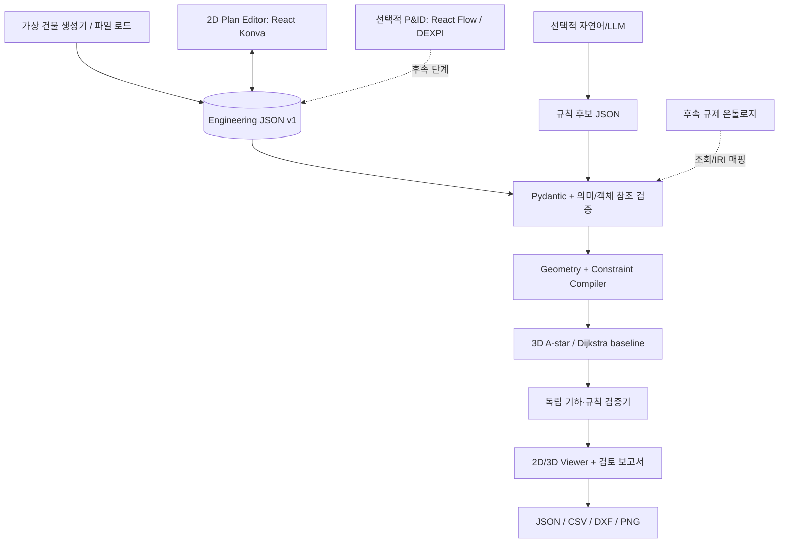

# PLAN_ROUTE: 원자력발전소 설계 제약조건 기반 3D 배관 라우팅 최적화 연구·개발 로드맵

> **버전**: v1.16 / 2026-10-13 P10D 공개 기준 사례·변경 검증·연구성 검토
> **문서의 용도**: 연구과제 기획 + Codex 구현 지시서 + 기능 검수 기준 + 논문 실험 계획  
> **대상 프로젝트**: `plan_route` / Python 3.12 + `uv` + FastAPI + React/TypeScript/Vite  
> **핵심 원칙**: *LLM이 없어도 라우팅과 검증이 동작하도록 설계*. React Konva/Three.js/LLM/온톨로지는 독립 모듈로 연결한다.

---

## 현재 진행 상태와 논문 우선순위 (2026-10-13 갱신)

**P00~P08c와 P10A·P10B·P10C의 합성 실험 및 논문 주장·비교표 초안을 완료했다. 다음은 브라우저 수동 검수와 미열람 비교 원문 보완이다. 실무 일반화와 선행연구 대비 우월성은 입증되지 않았다.**
체크된 Phase는 기능 구현 이력이며, 모든 입력에 대한 정확성이나 논문 주장의 입증을 뜻하지 않는다.
검토 기준 커밋은 `392305b`다. 상세 근거·선행연구 비교·재현 절차는
[구현 및 석사논문 검토 보고서](docs/reviews/2026-10-11-implementation-and-thesis-review.md)를 참조한다.
현재 주장·분모·선행연구의 절 근거와 열람 한계는
[2026-10-13 주장·비교표](docs/reviews/2026-10-13-thesis-claims-and-comparison.md)에 정리했다.

P10D 공개 기준 사례와 연구성 검토를 완료했다. 벽 작업 여유·전기 전용 공간·화력 프로젝트 통로 높이의
4개 합성 사례, 사람 검토용 draft JSON, 144회 실행과 24개 분석적 입력을 보존했다.
최종 경로는 **108/144 성공**, 36회는 목표 연결선 자기 간섭으로 거부됐다. 연속 witness 4개는 유효했다.
정규화 요구와 KEEP_OUT 닿음 계약의 차이 2건, 기존 경로가 유효해도 격자 차단으로 비용이 늘어난 사례를 기록했다.
Python **255**, Ruff, frontend build 통과. 다음은 연결선 재탐색·같은 평가 축의 문헌 원문·평가 집합 보완이며
논문 제출 준비 완료 또는 신규성 확정은 아니다. [완료 및 연구성 검토](docs/reviews/2026-10-13-public-reference-and-research-readiness.md),
[ADR 0025](docs/decisions/0025-p10d-public-reference-examples.md)를 참조한다.

| 범위 | 현재 상태 | 남은 핵심 |
|---|---|---|
| P00~P04 | 스키마, 격자, 방향 A*, Hard Rule compiler 구현 | 격자 최적성과 연속공간 가능성 구분 |
| P05~P06 | 독립 기하 검사, API, 저장/로드·구형 기본값 호환 구현 | 과거 입력/반복 실행 기록 보존 |
| P07~P08 | 2D 편집·치수·스냅·규칙 UI·3D 연동 구현; 플랜트 세 배관·양 층·재승인·L2 드래그 검수 | 경유점·규칙 생성의 플랜트 브라우저 회귀는 남음 |
| P07b | **완료**: 빈 건물, 기기/Port/배관 생성·삭제·분류, 몸체 이동 시 Port 동반 이동 | 몸체는 합성 AABB·외부 접속점 |
| P07c | **완료**: 선택 속성·두 클릭 연결·점선/실선·상단 계산·접힌 상세 정보 | 작은 흐름과 플랜트 대표 흐름 검수; 모든 편집 조합은 미검수 |
| P07d | **완료**: 배치/연결 도구 분리, 2D/3D/프로젝트/결과 탭, 보조 보기·건물 설정 팝업, 연결점 관리 탭 | 접속점은 실제 노즐 형상이 아니며 모든 편집 조합은 미검수 |
| P07e | **완료**: 한글 프로젝트 이름·도면 위 저장, 막힌 연결점 설명·선택·강조 | 막힌 배치는 사용자가 수정; 충돌 검사 유지 |
| P07f | **완료**: 저장 목록·검색·선택 불러오기, 이름/개정 갱신, 예제 복사본 수정·재로드 | 파일 저장은 로컬 단일 프로세스, 다중 사용자/충돌 조정은 미구현 |
| P07g | **완료**: 저장 ID/파일명 안내, 미저장 이탈·전환 확인, 보조 창 크기 조절·최대화 | 자동저장/비정상 종료 복구·개정별 파일 복원은 미구현 |
| P07h | **완료**: 상단·최대화 여백 해제, 8방향 테두리 조절, 2D/3D 별도 브라우저 창 | 실제 듀얼 모니터 이동은 수동 검수 대상; 메인 창 유지 필요 |
| P07i | **완료**: 메인에서 계속, 보기 버튼 그룹, 창 비율·중앙 배치·소속 창 측정/그리기, 확인 후 저장본 삭제 | OS 전면 창은 브라우저에 따름; 삭제 복원·다중 프로세스 조정은 미구현 |
| P08b | 순서 경유점·통과 축·자기 간섭 재탐색 구현 | 물리 관통부/공차 모델은 P09B 범위 |
| P08c | **완료**: 반례 회귀, 방향·검증 정책, exact/heuristic 메타데이터, 승인 내용 연결 | 브라우저 재승인 대표 흐름 확인; 승인 UI 전체 조합·완전성·우월성은 미입증 |
| P09 | 일부 기반만 존재: bend 가중치, JSON 결과 저장 | Soft Zone/관통부/다배관/CSV·DXF 미구현; 선택 확장 |
| P10A | **완료**: 11개 분석적 장면, 독립 기준 비용, 44회 실행 보존·CSV·단계별 시간 | 예비 계약 검사이며 본 비교 실험 아님 |
| P10B | **완료**: 개발 35/평가 14개, 2해상도·600회, 독립 소형 기준·통계·PNG/PDF | 합성 family/적은 평가 seed cluster의 한계 |
| P10C | **완료**: 12개 규칙 대조 입력·1,008회, 전후 경로 재검증·승인/출처/객체/구간 연결 | 단일 Zone family·평가 seed 2개; 실무/외부 법규 완전성 미입증 |
| P10D | **완료**: 적용 조건을 명시한 공개 기준 4개 사례, 144회 실행·경계/근거 검수·연구성 판정 | 36회 최종 거부·닿음 의미 차이 보존; 신규성/실무 일반화/게재 가능성 미확정 |
| P11~P12 | 미구현 | LLM/온톨로지는 선택 후속 연구 |

P07i 최신 검수: Python **226**, editor **41**, viewer **12**, Ruff/lint/build와 브라우저 **113개** 흐름 통과, 미처리 오류 0건.
보기/삭제 집중 검수 **23개**도 통과했다. 실제 메인 RAF를 차단해 별도 2D/3D 크기 측정·그리기를 검수했고,
카메라 중심과 8개 모서리 투영·Konva 전체 도면 표시를 확인했다. 삭제 취소·실패·개정 충돌·현재 문서 보존과 재저장도 확인했다.
정책·기록은 [ADR 0024](docs/decisions/0024-p07i-view-layout-and-project-deletion.md)에 있다.
P07h 검수 기록: Python **219**, editor **40**, viewer **11**, Ruff/lint/build와 브라우저 **90개** 흐름 통과, 미처리 오류 0건.
8방향 pointer drag, y=0 이동/전체 viewport 최대화, 별도 2D/3D 문서·계산/선택/편집 공유,
설정 modal/키보드 소속 문서와 보조 창/메인 새로고침의 정리를 검수했다. 실제 물리 모니터 이동은 미실시다.
기존 74개에 전체 합성 플랜트의 대표 흐름 16개를 추가했다. 세 배관의 독립 검증, 양 층 표시,
이격 규칙 0.5→0.75 m 변경·미승인 차단·내용 연결 재승인, L2 기기/Port 드래그,
별도 창 선택/계산 공유와 저장 재로드를 검수했다. 응답 7건·캡처·재현 절차는 [ADR 0023](docs/decisions/0023-p07h-window-edges-and-detached-views.md)에 기록했다.
P07g 검수: Python **219**, editor **39**, viewer **11**, Ruff/lint/build와 브라우저 **57개** 흐름 통과, 미처리 오류 0건.
이름 draft·취소·저장 실패·저장 후 전환·잘못된 JSON·실제 새로고침 확인·저장 후 경고 해제,
2D/3D canvas 크기 변화와 작은 화면의 창 배치를 검수했다. 탐색/검증/백엔드 저장 계약은 바꾸지 않았다.
P07f 검수: Python **219**, editor **37**, viewer **11**, Ruff/lint/build와 브라우저 **42개** 흐름 통과, 미처리 오류 0건.
이름 변경 후 목록 반영·새로고침 후 선택 불러오기·예제에 추가한 기기/배관 보존과 원본 유지를 검수했다.
P07e 검수 기록: Python **216**, editor **36**, viewer **11**, Ruff/lint/build와 브라우저 **34개** 흐름 통과, 미처리 오류 0건.
이름 없는 기존 JSON·저장 해시 호환을 유지하고, 저장 전 막힌 배치를 수정한 후 계산·독립 검증 성공을 확인했다.
P07d 검수 기록: Python **214**, editor **34**, viewer **11** 테스트와 Ruff/lint/frontend build 통과.
P07d는 처음부터 빈 건물로 시작하며 예제는 프로젝트 탭에서 불러온다. UI 변경으로 탐색·검증 알고리즘은 바꾸지 않았다.
Edge 실제 브라우저 **28개** 흐름과 JSON 하위 탭·3D 속성 수정/경로 계산·2D 결과 공유·연결점 추가/삭제·모달 오류/키보드 격리·보조 창 이동을 검수했다. 미처리 브라우저 오류 0건.
P07c 검수 기록: Python **214**, editor **32**, viewer **11** 테스트와 Ruff/lint/frontend build 통과.
Edge 실제 캔버스 클릭·FastAPI 계산·속성 이동·삭제 보호/Undo·3D 렌더·390 px 가로 넘침 검사 통과, 미처리 브라우저 오류 0건.
실제 프런트 편집 함수의 빈 JSON→기기/배관 생성·이동 결과로 API 검증·저장/로드·A*/Dijkstra·독립 검증을 확인했다.
P10C 당시 검수: Python **212** 테스트, Ruff, frontend build 통과. 기본 1,008회 모두 기대 계약 일치,
308쌍 대조 중 성공 exact 224쌍의 유한 변화량 분석; 승인/출처/대상 1,428건·규칙/객체/구간 708건 연결 완전.
이는 이 합성 입력의 연결 검수이며 검증기·실제 규정의 완전성 증명이 아니다.
P10C 실험은 P07b에서 탐색/검증 알고리즘을 바꾸지 않아 재실행하지 않았다. 브라우저/WebGL 수동 시연은 남아 있다.
역행 경로의 분할 전후 판정, 이후 유효 경유점 통과, 포트 방향·대각선 반례를 수정했다.
별도 소형 그래프 기준 계산과 A*/Dijkstra 비용을 대조했다. 테스트 수를 검증기의 완전성 증명으로 쓰지 않는다.
계약·승인 호환·미실시 검사는 [P08c 설계 결정](docs/decisions/0013-p08c-validation-and-approval-contract.md)에 기록했다.

**석사논문 남은 순서**: 브라우저 시연 기록 → 미열람 비교 원문·PDF 쪽 보완 → 필요한 P09만 선택.
P10 문서 보완에서 주장·분모·6개 선행연구 비교표 초안을 작성하고 보존 로그 600/1,008회의 합계 및
source.zip manifest 41/44개 hash를 검수했다. 새 벤치마크 실행이나 비교 우위 입증은 아니다.
Hard Rule·길이·bend 비교와 규칙 변경·근거 연결 대조를 합성 입력에서 확보했다.
차별성 문장은 같은 문제 범위의 선행연구와 비교해 별도로 확정해야 한다.
각 요청에서는 이 중 하나의 작업 단위만 수행한다. 다배관·LLM·온톨로지·CAD 전체 구현을 학위논문의 전제조건으로 두지 않는다.

---

## 빠른 재현: GitHub에서 받아 실행하기

저장소: https://github.com/shstorage/plan_route (기본 브랜치 `main`)

**사전 설치**

| 도구 | 버전 | 비고 |
|---|---|---|
| Git | 최신 | |
| [uv](https://docs.astral.sh/uv/) | 0.12 이상 권장 | Python 3.12는 `.python-version`을 보고 uv가 자동으로 받습니다. 따로 설치할 필요 없음 |
| Node.js | 22.18 이상 | `npm run test:editor`/`test:viewer`가 Node의 TypeScript 타입 제거 실행을 사용 |

확인한 환경: Windows 11, Python 3.12.14, uv 0.12.7, Node.js 22.23.2.

**1) 받기와 의존성 복원**

```bash
git clone https://github.com/shstorage/plan_route.git
cd plan_route

# 백엔드: uv.lock에 고정된 버전 그대로 설치(.venv 생성)
uv sync --locked

# 프런트엔드: package-lock.json에 고정된 버전 그대로 설치
cd frontend
npm ci
cd ..
```

`uv sync`(잠금 없이)나 `npm install`은 잠금 파일을 바꿀 수 있으므로, 재현할 때는 `--locked` / `npm ci`를 씁니다.
`uv init`·`npm create vite`는 다시 실행하지 않습니다(§4.1).

**2) 설치가 맞는지 테스트로 확인**

```bash
# 프로젝트 루트
uv run pytest -q
uv run ruff check .

# 프런트엔드
cd frontend
npm run test:editor
npm run test:viewer
npm run lint
npm run build
cd ..
```

모두 통과해야 같은 상태가 재현된 것입니다.

**3) 실행 (터미널 2개)**

```bash
# 터미널 1 — 프로젝트 루트: API 서버
uv run uvicorn plan_route.main:app --reload --host 127.0.0.1 --port 8000

# 터미널 2 — frontend/: 웹 UI
cd frontend
npm run dev -- --host 127.0.0.1
```

브라우저에서 http://127.0.0.1:5173 을 엽니다. 빈 건물(20×12×6 m)에서 시작합니다.
합성 플랜트 예제(60×40×12 m, 2개 층)는 **프로젝트 → 저장·불러오기 → 예제 불러오기**로 엽니다.
API 문서는 http://127.0.0.1:8000/docs, 상태 확인은 http://127.0.0.1:8000/api/health 입니다.

**참고**

- 저장한 프로젝트와 경로 결과는 `data/projects/`, `data/results/`에 생기며 Git에는 올라가지 않습니다. 처음 실행 시 자동으로 만들어집니다.
- API 서버는 `127.0.0.1:5173`/`localhost:5173`에서 오는 요청만 허용(CORS)합니다. 5173 포트가 이미 쓰이면 Vite가 다른 포트로 옮기지 않고 종료하므로, 사용 중인 프로세스를 먼저 끕니다.
- API 주소를 바꾸려면 `frontend/.env.example`을 `frontend/.env.local`로 복사해 `VITE_API_BASE_URL`을 고칩니다. 이 파일에 비밀키를 넣지 않습니다.
- 기능별 사용법과 수동 검수 절차는 `README.md`, 설계 결정은 `docs/decisions/`를 봅니다.

---

## 0. 한눈에 보는 결론과 실행 지침

### 0.1 제안 연구 제목

- **국문(추천)**: *추적 가능한 설계 제약의 공간 컴파일과 독립 기하 검증을 이용한 3차원 배관 경로 생성 및 변경 영향 분석*
- **영문**: *Traceable Spatial Constraint Compilation and Independent Geometric Verification for 3D Pipe Routing and Change-Impact Analysis*
- **후속 LLM 연구**: *자연어 설계 요구사항의 제약조건 정형화와 검증 기반 배관 경로 최적화 연계*
- **원전 분야 적용 문구**: *원전 건물의 특성을 모사한 합성 벤치마크로 개념 검증*. 실제 원전 설계나 인허가 적합성을 인증하는 프로그램이 아님.

### 0.2 가장 중요한 기술 선택

| 계층 | MVP 결정 | 이후 선택적 확장 | 선택 이유 |
|---|---|---|---|
| 백엔드/API | FastAPI + Pydantic v2 | 작업 큐/DB | 기존 `uv` 프로젝트 재사용 |
| 데이터 | **도메인 중심 Engineering JSON** | JSON-LD/RDF/Neo4j | UI 라이브러리에 종속되지 않음 |
| 탐색 알고리즘 | **직접 구현한 3D A\*** | Dijkstra, 순차 다배관, 재라우팅, GA/RL | 방향 상태·비용 분해·검증 가능 |
| 공간 모델 | AABB/박스형 장애물 + 규칙적 3D Grid | 다각형, 메시, CAD/BIM | 먼저 수학적 정확성 검증 |
| 2D 편집 | **React Konva** | DXF/IFC 편집·가져오기 | 벽/구역/좌표 중심 |
| 3D 보기 | React Three Fiber(Three.js) | STEP/IFC | 최적화 결과 시각화 |
| P&ID 편집 | MVP **제외** | React Flow + DEXPI | 연결 논리 검토가 별도 연구 주제 |
| 규칙 | Enum + Pydantic + Python 실행 함수 | SHACL/OWL + 온톨로지 | 규칙 해석과 실행 분리 |
| LLM | MVP **제외** | 자연어→규칙 후보 + 설명 | LLM 필수화로 인한 불확실성 제거 |
| 저장 | 버전 관리되는 JSON 파일 | SQLite/PostgreSQL | 초기 재현성 우선 |
| 도면 출력 | JSON/CSV/2D DXF/PNG | PDF/3D STEP/IFC | 연구 기여와 엔지니어링 구분 |

**최종 목표 시연**: ① 가상 건물 불러오기 → ② 2D에서 장애물/금지구역/배관 시작·종점 편집 → ③ 규칙 입력 → ④ 3D A* 실행 → ⑤ 2D/3D 경로 표시 → ⑥ 독립 검증 → ⑦ 규칙 출처/위반/경로 비교 → ⑧ JSON/CSV/DXF 내보내기.

### 0.3 MVP 범위와 하지 않을 일

**MVP 반드시 포함**: 단일 배관 3D 경로, 6방향 이동, 거리·엘보 비용, 금지구역, 최소 이격, 가상 모델, 검증 보고서, 2D/3D 뷰어, 저장/불러오기, 회귀테스트.

**MVP 이후 선택**: 관통부 조건, 선호구역, 2개 이상 배관 간 이격, 배관 순차 배치, rip-up/reroute, LLM, 온톨로지, DXF 가져오기.

**초기 제외**: 원자로 건물 실제 배치 재현, 원전 인허가 자동 판정, ASME 코드 전체 자동 검증, 배관 응력/내진/HELB/Pipe Whip 해석, 지지대 위치 자동 산정, FAC 정량 예측, 실무용 3D CAD 완전 호환, 강화학습, 복잡한 P&ID 편집기.

### 0.4 Codex 작업 방식(중요)

> 이 문서 **전체를 한 번에 구현하도록 시키지 않는다.** 1개 Phase만 Codex에 지정하고, 완료 조건(DoD)·테스트를 만족하면 다음 Phase로 넘어간다.

1. `plan_route` 루트에 이 파일을 `ROADMAP.md`로 복사한다.
2. 별첨 `AGENTS.md`가 있으면 프로젝트 루트에 복사한다.
3. 맨 아래 **[17. Codex에 첫 번째로 넣을 프롬프트](#17-codex에-첫-번째로-넣을-프롬프트)**로 시작한다.
4. 매 Phase 완료 시 `uv run pytest`, `uv run ruff check .`, `cd frontend && npm run build` 등 해당 검수 명령을 실행한다.
5. 완료된 Phase는 체크박스 표시, 결정사항은 `docs/decisions/`에 기록, 다음 단계는 독립 PR/커밋으로 진행한다.

---

## 1. 연구 동기·문제 정의·가설

### 1.1 해결할 문제

공간 제약과 복잡한 설계 요구조건이 존재하는 건물의 배관 라우팅은 단순 최단거리가 아니다. 실무에는 벽체, 설비, 금지구역, 배관의 외경/보온재, 정비 여유공간, 구획 관통 허용 위치, 이종 계열 배관 이격, 엘보 수 등의 요구조건이 동시에 존재한다. 이들 조건이 문장·도면·CAD 속성에 흩어져 있으면 자동 최적화에 활용하기 어렵고 결과에 어떤 규칙이 작용했는지 설명하기 어렵다.

### 1.2 연구 질문(RQ)

- **RQ1**: 공간 객체와 추적 가능한 규칙 JSON을 이용해 복수 제약조건을 3D 라우팅 그래프로 *결정론적*으로 변환할 수 있는가?
- **RQ2**: Hard Constraint의 위반 없이, 길이·엘보·선호구역과 같은 Soft Objective를 비교 가능하게 최적화할 수 있는가?
- **RQ3**: 규칙을 추가·삭제·변경했을 때 경로 변화의 원인과 적용 근거를 정량적으로 추적할 수 있는가?
- **RQ4(후속)**: 비정형 자연어를 LLM이 생성한 규칙 후보로 변환하고, 검증·사람 승인 후 적용할 때 수작업 입력과 어느 정도 일치하는가?

### 1.3 검증 가능한 가설 예시

- **H1**: 동일한 컴파일 격자·목적함수에서, 탐색 예산이 충분하고 휴리스틱 재탐색을 사용하지 않은 A*의 비용은 기준 계산과 일치한다. 자기 간섭을 포함한 전체 문제와 연속공간의 완전성은 별도로 평가한다.
- **H2**: 방향을 상태에 포함한 A*는 길이만 고려한 A*보다 엘보 가중치가 있는 비용함수를 정확하게 반영한다.
- **H3**: 규칙-공간 객체-경로 세그먼트 간 provenance를 저장하면 규칙 변경에 따른 경로 차이와 원인을 재현 가능하게 보고할 수 있다.
- **H4(후속)**: LLM 출력에 스키마·객체 참조·근거·승인 검증을 추가하면 프롬프트 단독 접근보다 실행 가능한 잘못된 규칙의 수를 감소시킨다. (실험으로만 판정, 사전 보장 금지)

### 1.4 신규성에 대한 보수적 판단

- **기존에 존재**: 3D 자동 라우팅, Dijkstra/A*, 배관 다목적 최적화, P&ID 데이터 추출, LLM 활용 비용 가중치 조정, 원전 배관의 안전/방사선 구역 제약.
- **우리의 후보 기여**: UI-독립적인 규칙-공간 스키마, 검증 가능한 rule-to-geometry 컴파일러, 제약 충돌/불능 탐지, 변경 전후 추적 가능한 경로 평가 방법, 공개 합성 벤치마크.
- **주의**: 규칙 목록을 JSON으로 만들고 A*를 실행한 것만으로 SCI(E)급 신규성이 입증되지는 않는다. 기존 방법 대비 비교실험·실패 사례·분석이 필수.

---

## 2. 선행연구와 차별화 전략

| 연구·표준 | 확인된 핵심 | 본 과제의 차별화 질문 |
|---|---|---|
| Kong et al., IJNAOE 2026 | 객체·관계 규칙 정형화, Multi-agent LLM의 A* 결과 평가·비용 가중치 조정, 폐루프 최적화 | 고정 비용 아래 규칙 변경·승인/출처/객체/구간 연결을 대조한다; 규칙 정형화 자체의 최초성은 주장하지 않는다 |
| Kang et al., Sustainability 2024 | P&ID 디지털화 및 3D Dijkstra 라우팅/간섭 회피 | 주어진 연결·공간의 자동 라우팅 자체는 새롭지 않다 |
| Takahashi et al., Mechanical Engineering Journal 2026 | 원전 건물 내 제한구역, 방사선/안전분류를 고려한 배관 자동배치 | 원전 제약을 넣었다는 주장만으로 신규성 부족; 출처 추적·규칙 변경 효과·안전한 오류 탐지 강조 |
| Eastman et al., Automation in Construction 2009 | 규칙 해석·모델 준비·실행·보고의 단계적 자동 검사 | compiler/validator 분리의 일반 구조 자체를 최초 기여로 주장하지 않음 |
| Xie et al., Buildings 2022 | MEP 규칙 지식관리와 BIM 속성·간격 자동 검사 | 규칙 관리 UI·데이터 구조·이격 검사만으로 신규성 부족 |
| Anand et al., ARCHER 2026 v2 (프리프린트) | 감사 가능한 실행 규정 코드와 결정론적 검증 흐름 | 배관 변경 영향/기하 검증을 정량 평가해 차별화 검토 |
| DEXPI | P&ID 설계 데이터의 교환 모델 | React Flow 자체 JSON 대신 표준 매핑이 가능한 의미 모델 채택 |
| W3C JSON-LD/SHACL | 연결 데이터·RDF 그래프 검증 | 규칙 스키마와 온톨로지 확장 지점 설계에 활용 |

**주요 문헌(정확한 링크)**

1. Kong et al. (2026), *A method for pipe auto-routing using an LLM-based expert system*, IJNAOE 18, 100796. DOI: https://doi.org/10.1016/j.ijnaoe.2026.100796  
   **주의**: 일부 연구실 소개 페이지의 DOI 링크가 다른 저널 형식으로 보일 수 있으므로 논문 서지정보에는 위 출판사/학술 DB의 정식 DOI를 사용.
2. Kang et al. (2024), *Auto-Routing Systems (ARSs) with 3D Piping ...*, Sustainability 16(7), 2770. https://doi.org/10.3390/su16072770
3. Takahashi et al. (2026), *Development of AI automatic piping layout design system for nuclear power plants*. https://doi.org/10.1299/mej.25-00421
4. DEXPI 공개 사양: https://dexpi.org/specifications/
5. SHACL W3C Recommendation: https://www.w3.org/TR/shacl/
6. JSON Schema: https://json-schema.org/understanding-json-schema/reference
7. Eastman et al. (2009), *Automatic rule-based checking of building designs*. https://doi.org/10.1016/j.autcon.2009.07.002
8. Xie et al. (2022), *Automated Rule Checking for MEP Systems Based on BIM and KBMS*. https://doi.org/10.3390/buildings12070934
9. Anand et al. (2026), *ARCHER: Agentic Rule and Compliance Harness for Executable Regulations*, v2. https://arxiv.org/abs/2607.25566v2

**2026-10-13 차별성 검토**: 공개 본문/초록의 선별 비교이며 원문 전체에 대한 부재 증명이 아니다.
본문 절 근거와 초록만 확인한 항목은 [주장·비교표](docs/reviews/2026-10-13-thesis-claims-and-comparison.md)에서 구분한다.
후보 기여인 ① 출처·규칙 개정·공간 차단·경로 변화의 연결과 ② 격자 보수성/독립 검증의 제한된 반례에
P10B/C 합성 실험 근거를 확보했다. 실무 일반화·검증 완전성·선행연구 대비 신규성은 아직 입증하지 않았다.

---

## 3. 시스템 아키텍처: Topology / Geometry / Constraints / Solver를 분리



### 3.1 네 가지 좌표/표현을 엄격하게 분리

- **도메인 세계좌표**: 오른손 좌표계, `x,y,z` 단위 **m**. 원점은 연구용 건물 기준점. `z`는 수직 상향. 저장·최적화·검증의 유일한 기준.
- **2D 화면 좌표**: React Konva의 px. `screen = transform(world_xy, viewport)`로만 변환, JSON 도메인에는 픽셀 좌표를 저장하지 않는다.
- **3D 뷰어 좌표**: Three.js에서 필요하면 `(x,y,z) → (x,z,y)`처럼 축 매핑을 **별도 단일 함수**로 관리. 어떤 축을 up으로 사용하는지 README 명시.
- **Voxel 인덱스**: `(i,j,k)`는 `world_to_grid`/`grid_to_world`로 왕복, 중심점/셀 경계 처리 규칙을 테스트로 보장.

### 3.2 단일 진실 공급원(Single Source of Truth)

- `EngineeringProject` Pydantic 모델을 **정본 데이터 모델**로 사용.
- 프런트엔드는 같은 계약을 TypeScript로 표현하고 API에서 검증.
- `Konva.Stage.toJSON()`이나 React Flow의 `nodes/edges`를 정본으로 사용하지 않는다. 공식 Konva 문서도 React에서는 앱 상태 저장을 권고한다.
- 계산용 Voxel, Cost Map, 3D Mesh, SVG/PNG는 항상 정본에서 **파생**되도록 한다.

---

## 4. 프로젝트 시작 상태와 실행 명령

### 4.1 사용자 제공 초기 구성: **이미 수행됨 — 다시 생성하지 말 것**

```bash
uv init plan_route --python 3.12
cd plan_route
uv sync
uv add fastapi 'uvicorn[standard]' pydantic

npm create vite@latest frontend -- --template react-ts
cd frontend
npm install
```

**주의**: Codex는 `uv init`이나 `npm create vite`를 재실행하지 않는다. `uv init` 생성 레이아웃은 uv 버전에 따라 `src/plan_route/` 등이 존재할 수 있으므로 우선 `ls` 또는 `tree`로 **실제 구조 확인**. `pyproject.toml`, `uv.lock`, `frontend/package*.json`을 불필요하게 재작성하지 않는다.

### 4.2 권장 추가 의존성(단계별로 설치)

프로젝트 루트에서:

```bash
# Phase 0~3: 백엔드 / 실험용
uv add numpy
uv add --dev pytest pytest-cov httpx ruff

# 2D 상세 거리 계산이 필요해질 때 추가
uv add shapely

# DXF 내보내기 Phase에서만 추가
uv add ezdxf

# 그래프 알고리즘 기준 구현 비교가 필요할 때만
uv add networkx
```

프런트엔드 `frontend/`에서:

```bash
# 2D 편집 Phase
npm install react-konva konva

# 3D 시각화 Phase
npm install three @react-three/fiber @react-three/drei
npm install -D @types/three

# 선택: 앱 상태/서버상태 관리가 실제 필요해질 때만
# npm install zustand @tanstack/react-query
```

**버전 원칙**: 설치 시점에 npm 의존성을 확인. React 19에서는 이에 호환되는 React Konva/React Three Fiber 버전을 사용할 것. 동작 확인한 버전은 `uv.lock`, `package-lock.json`으로 고정한다.

### 4.3 개발 서버

프로젝트 루트 터미널 1:

```bash
uv run uvicorn plan_route.main:app --reload --host 127.0.0.1 --port 8000
# http://127.0.0.1:8000/docs
```

터미널 2:

```bash
cd frontend
npm run dev -- --host 127.0.0.1
# http://127.0.0.1:5173 (점유 시 다른 포트 가능)
```

- Python 백엔드는 기존 uv 패키지 `src/plan_route/`에 통일한다. `src/plan_route/__init__.py`를 유지하고 루트에 별도 백엔드 패키지를 만들지 않는다.
- `uv sync --locked`로 설치되는 `plan_route` 패키지를 사용한다. 코드와 테스트의 import는 `plan_route.*`이며 임의의 `sys.path`/`PYTHONPATH` 조작은 사용하지 않는다.
- FastAPI CORS는 개발용 `http://127.0.0.1:5173`, `http://localhost:5173`만 명시적으로 허용.
- `.env` 또는 `frontend/.env.local`에는 `VITE_API_BASE_URL=http://127.0.0.1:8000`을 사용하되 민감한 비밀키를 `VITE_` 변수로 저장하지 않는다.
- 127.0.0.1 바인딩은 본인 PC 로컬 개발을 위한 선택. 컨테이너/원격 접속용이면 네트워크 바인딩·접근 제어 별도 설계.

---

## 5. 권장 디렉터리 구조(Codex가 순차적으로 생성)

```text
plan_route/
├── ROADMAP.md                      # 이 문서
├── AGENTS.md                       # Codex 작업 규칙
├── pyproject.toml                   # 이미 있음
├── uv.lock                          # 이미 있음
├── .python-version                  # 이미 있음
├── src/
│   └── plan_route/                 # uv가 설치하는 Python 백엔드 패키지
│       ├── __init__.py
│       ├── main.py                   # FastAPI, CORS
│       ├── api/
│       │   ├── __init__.py
│       │   ├── health.py
│       │   ├── projects.py
│       │   ├── constraints.py
│       │   ├── routing.py
│       │   └── export.py
│       ├── models/
│       │   ├── __init__.py
│       │   ├── geometry.py
│       │   ├── engineering.py
│       │   ├── constraints.py
│       │   └── results.py
│       ├── services/
│       │   ├── project_store.py
│       │   ├── geometry.py
│       │   ├── voxel_grid.py
│       │   ├── compiler.py
│       │   ├── astar.py
│       │   ├── path_validator.py
│       │   ├── multi_route.py        # 선택 단계
│       │   ├── explanation.py
│       │   └── dxf_export.py         # 선택 단계
│       └── fixtures/
│           └── demo_project.json
├── frontend/                        # 기존 Vite 유지
│   ├── src/
│   │   ├── app/
│   │   ├── api/
│   │   ├── types/
│   │   ├── features/
│   │   │   ├── project/
│   │   │   ├── plan-editor/          # React Konva
│   │   │   ├── constraint-editor/
│   │   │   ├── route-results/
│   │   │   └── viewer-3d/           # React Three Fiber
│   │   └── components/
│   ├── vite.config.ts
│   └── package.json
├── datasets/
│   ├── synthetic/
│   │   ├── README.md
│   │   ├── cases/                    # seed 고정된 JSON
│   │   └── manifests/
│   └── gold/                         # 전문가 정답(후속)
├── scripts/
│   ├── generate_scenarios.py
│   ├── run_benchmark.py
│   └── summarize_results.py
├── tests/
│   ├── test_schemas.py
│   ├── test_voxel_grid.py
│   ├── test_astar.py
│   ├── test_constraint_compiler.py
│   ├── test_validator.py
│   ├── test_api.py
│   └── test_regressions.py
├── reports/
│   ├── experiments/                 # csv/json 및 그림
│   └── figures/
└── docs/
    ├── decisions/                   # ADR 문서
    ├── api_contract.md
    ├── schema.md
    ├── experiment_protocol.md
    └── research_log.md
```

**Phase 0에서는 트리 전체를 만들지 말고 필요한 파일만 생성.** 사용하지 않는 빈 서비스/디렉터리 선생성 금지.

---

## 6. Engineering JSON: 논문과 소프트웨어가 공유하는 핵심 데이터

### 6.1 기본 엔터티 정의

| 엔터티 | 필수 속성 | 설명 |
|---|---|---|
| Project | `id`, `schema_version`, `unit_system`, `coordinate_frame` | 데이터 버전/좌표 약속 |
| Building | `bounds`, `floors` | 전체 설계 가능 공간 |
| Equipment | `id`, `kind`, `geometry_ref`, `ports` | 펌프/열교환기/탱크 등 |
| Port | `id`, `position_m`, `orientation` | 배관 연결점과 진입/출구 방향 |
| Obstacle | `id`, `geometry` | 벽체/기기/기둥 등 물리적 충돌체 |
| Zone | `id`, `zone_type`, `geometry` | 금지/선호/방화 등 공간 속성 |
| Pipe | `id`, `from_port_id`, `to_port_id`, `outer_diameter_m`, `insulation_m` | 배관 라우팅 수요 |
| Constraint | `id`, `type`, `severity`, `scope`, `parameters`, `source`, `status` | 실행할 규칙 |
| RoutingConfig | `grid_resolution_m`, `cost_weights`, `search_limits` | 실험 재현성 |
| RouteResult | `pipe_id`, `points_m`, `metrics`, `violations`, `provenance` | 결과 및 검증 이력 |

### 6.2 권장 JSON 골격(가상 예제; 건물·수치 모두 실험용)

```json
{
  "schema_version": "1.0.0",
  "project_id": "SYNTH-DEMO-001",
  "study_type": "synthetic_benchmark",
  "unit_system": "SI",
  "coordinate_frame": {
    "name": "BUILDING_LOCAL",
    "unit": "m",
    "up_axis": "z",
    "origin_m": [0.0, 0.0, 0.0]
  },
  "building": {
    "bounds_m": {"min": [0, 0, 0], "max": [12, 10, 4]},
    "floors": [{"id": "L1", "z_min_m": 0, "z_max_m": 4}]
  },
  "obstacles": [
    {
      "id": "WALL-01",
      "kind": "wall",
      "shape": {"type": "aabb", "min_m": [5, 0, 0], "max_m": [5.5, 7, 4]}
    }
  ],
  "zones": [
    {
      "id": "ZONE-A",
      "zone_type": "restricted",
      "shape": {"type": "aabb", "min_m": [4, 4, 0], "max_m": [7, 8, 4]}
    }
  ],
  "equipment": [
    {"id": "PUMP-101", "kind": "pump", "ports": [{"id": "PORT-A", "position_m": [1, 2, 1]}]},
    {"id": "HX-101", "kind": "heat_exchanger", "ports": [{"id": "PORT-B", "position_m": [11, 2, 1]}]}
  ],
  "pipes": [
    {
      "id": "PIPE-101",
      "from_port_id": "PORT-A",
      "to_port_id": "PORT-B",
      "outer_diameter_m": 0.1,
      "insulation_thickness_m": 0.02,
      "train_id": "A"
    }
  ],
  "constraints": [
    {
      "id": "RULE-001",
      "type": "KEEP_OUT",
      "severity": "hard",
      "scope": {"pipe_ids": ["PIPE-101"], "target_ids": ["ZONE-A"]},
      "parameters": {},
      "source": {
        "source_type": "synthetic_assumption",
        "document_id": "DEMO-SPEC",
        "document_revision": "1",
        "clause_id": "TEST-01",
        "evidence_text": "PIPE-101 shall not enter ZONE-A"
      },
      "status": "approved"
    }
  ],
  "routing_config": {
    "grid_resolution_m": 0.5,
    "cost_weights": {"length_per_m": 1.0, "bend_per_event": 2.0, "preferred_zone_factor": 0.8},
    "search_limits": {"max_expansions": 500000}
  }
}
```

**중요 구현 주의점**

- 위 데이터는 **외부 인터페이스 예제**다. Pydantic 모델에서 `bounds_m`, `shape`, `scope`, `source`의 타입을 강하게 정의한다.
- `shape.type`은 우선 `aabb`만 허용한다. 사각형은 최소점/최대점이 모든 축에서 엄격히 순서 관계를 만족해야 한다.
- `PORT-A`가 실제 equipment의 포트인지, 포트가 건물 내부인지, 객체 ID 중복이 없는지, 모든 참조 ID가 존재하는지 검사.
- P01 소형 예제의 두 Equipment는 연결 포트 정의만 갖는다. 플랜트 예제와 P07b 신규 기기는
  `geometry_ref → Obstacle.shape`로 합성 점유 형상을 연결한다. 실제 장비/노즐 형상은 아니다.
- **시스템 내부 규칙이 다르면 예제도 함께 변경**한다. `datasets/synthetic/cases/demo_001.json`을 유일한 실제 Fixture로 관리하고 문서와 테스트가 이를 참조하도록 한다.
- 좌표·수치/거리 기준에 대한 원전 규정 근거가 아니라 *연구자 가정*이라는 `source_type`을 절대로 생략하지 않는다.

### 6.3 데이터 무결성 규칙

1. ID는 엔터티 전체에서 유일하며 변경 후에도 provenance에서 연결 가능.
2. `schema_version` 기준으로 파서가 버전을 검사. 알 수 없는 Major version이면 거절.
3. 수치 단위는 저장 시 SI. 화면에서 mm를 입력해도 데이터 계층에서 m로 변환.
4. 모든 규칙은 `source_type`, `document_id`, `status` 필수. 실험용일 때도 예외 없음.
5. 승인되지 않은 `draft`, `needs_review`, `rejected` 규칙은 **라우팅 적용 불가**.
6. 모든 2D 편집은 월드좌표로 환산한 뒤 저장.
7. `save(load(project))`의 의미 동등성 확인(필드 순서 제외).
8. JSON 출력은 재현성을 위해 키 정렬/부동소수점 정밀도/실험 시드 정책을 결정.

---

## 7. Constraint DSL 및 온톨로지 확장 설계

### 7.1 규칙 정의: Hard와 Soft를 명확히 구별

| 코드 | 종류 | 필수 데이터 | 해석/실행 | MVP |
|---|---|---|---|---|
| `KEEP_OUT` | Hard | `pipe_ids`, `zone_ids` | 배관 swept volume이 대상 Zone과 교차 불가 | 필수 |
| `MIN_CLEARANCE` | Hard | `pipe_ids`, `target_ids`, `distance_m`, `distance_basis` | 배관 외면(필요 시 보온재 포함)과 객체/영역 사이 최단거리 검증 | 필수 |
| `ALLOWED_PASSAGE` | Hard의 명시적 예외 | `wall_id`, `opening_id`, `pipe_ids` | 지정된 개구부를 통과하는 경우에만 해당 벽체 관통 가능 | 확장 |
| `TRAIN_SEPARATION` | Hard | `train_a`, `train_b`, `distance_m` | 서로 다른 Train 배관 swept volume 간 최소거리 | 확장 |
| `PREFERRED_ZONE` | Soft | `pipe_ids`, `zone_ids`, `factor` | 통과 비용을 양의 비율로 조정 | 확장 |
| `AVOID_BEND` | Soft/목적함수 | `bend_cost`, `pipe_ids` | 방향 전환 비용 증가 | 필수(설정값) |

`AVOID_BEND`처럼 **전체 목적함수 항목**과 `KEEP_OUT`처럼 **지역 조건 규칙**은 실행 엔진에서 별도로 취급한다. 하나의 Enum에 넣더라도 처리 경로를 분리한다.

### 7.2 가장 조심할 규칙: 허용 관통부

- `ALLOWED_PASSAGE`는 무조건 통과를 허용하는 만능 규칙이 아니다.
- 벽체를 관통할 수 있는 조건은 **(해당 배관의 개구부 사용 승인) AND (배관 외경+여유공간이 개구부 치수에 적합) AND (다른 규칙을 위반하지 않음)**.
- 금지구역에 `ALLOWED_PASSAGE`가 우선한다는 일반화는 금지. 벽/개구부 객체 범위의 **한정된 예외**만 모델링.
- 충돌하는 Hard Rule이 생기면 자동으로 하나를 무시하지 말고 `RULE_CONFLICT`나 `NO_FEASIBLE_ROUTE`를 보고.

### 7.3 거리 정의를 하나의 문장으로 고정

- 기본 `MIN_CLEARANCE`: **배관 보온재 외면과 대상 장애물 표면 사이의 최단 3D 거리**.
- 배관 중심선 좌표와 외경/보온 두께를 사용: `effective_radius_m = outer_diameter_m/2 + insulation_thickness_m`.
- 목표 여유거리 `d`가 있으면 장애물 확장 반경은 이론상 `effective_radius_m + d`(적용 대상 기하/유효 영역 확인 필요).
- Centerline 거리와 Surface clearance를 혼용하지 않는다. 각 `Constraint`에 `distance_basis`/설명 명시.

### 7.4 온톨로지 친화적인 필드 설계

| 필드 | 지금 하는 역할 | 이후 온톨로지 |
|---|---|---|
| `subject/target IDs` | 배관/Zone 객체 참조 | 인스턴스 IRI로 매핑 |
| `rule.type` | 결정론적 함수 디스패치 | Rule Class IRI |
| `source.document_id/clause_id/revision` | 규정 근거 추적 | Citation/Document 노드 |
| `applicability` | 적용 대상 조건 | 클래스/속성 기반 질의 |
| `status/approved_by/approved_at` | 승인 상태/감사 이력 | provenance/프로세스 모델 |
| `ontology_iri`(optional) | 미사용 | 추후 OWL/RDF 연결 |

- 온톨로지는 초기에 만들지 않는다. 인터페이스가 안정된 후 JSON-LD 매핑과 RDF Export를 추가.
- `SHACL`은 데이터 그래프 검증용. 물리 배관의 3D 간섭/거리 검증은 **Python geometry validator**가 해야 한다.
- **독립성**: 규칙 DB와 솔버는 온톨로지 서버가 꺼져도 작동해야 한다.

### 7.5 규칙 검증 파이프라인

```text
요구사항/도면/UI
  └→ 구조 검증(Pydantic)
       └→ 참조 검증(배관/Zone/Port ID 존재)
            └→ 적용 범위 검증(타입·Train·규칙 상태)
                 └→ 정량 근거 검증(출처·단위·거리 기준)
                      ├─ 승인됨 → Constraint Compiler
                      └─ 불명확/충돌 → needs_review / 중단
```

---

## 8. 공간 모델링과 3D 최적화의 상세 설계

### 8.1 가상 건물의 초기 구성

- **초기 UI 데모**: `12 m × 10 m × 4 m`, 단일 층, 벽 1개, 제한구역 1개, 펌프/열교환기 포트 2개, 배관 1개.
- **확장 실험**: `36 m × 24 m × 12 m`, 층 3개, 기기/벽/구역 10~30개, 배관 2~5개.
- **초기 Grid 해상도**: `0.5 m`, 이후 `0.25 m`, `1.0 m` 민감도 평가. 해상도에 따른 계산량 증가를 기록.
- 연속 3D 공간을 보수적으로 Grid에 투영. 셀이 일부만 장애물/금지영역과 겹치면 통과 불가로 처리하는 초기 정책을 명시한다.
- 포트가 장애물에 접하는 상황을 고려해 **장비 외부 연결점과 허용 출구 방향**을 별도 모델링한다. 장비 내부로 배관이 관통하지 않도록 한다.

### 8.2 Grid/좌표의 수학적 정의

- `resolution=r`일 때 셀 `(i,j,k)`의 중심: `(x0+(i+0.5)r, y0+(j+0.5)r, z0+(k+0.5)r)`.
- world→grid는 바닥(floor) 인덱스를 사용하고, 범위 끝점/경계/수치오차를 테스트.
- 임의 포트 좌표의 셀 스냅은 허용오차를 확인하고, 연결점 원 좌표→스냅 좌표 보정 세그먼트를 **검증 대상**에 포함.
- 이동은 처음 `±X, ±Y, ±Z` 6-연결. 대각 이동/곡선/자유 각도는 후속.
- 셀 검사뿐 아니라 **연속 선분(또는 피복된 배관 형상)**의 벽·Zone 교차를 최종 검증해야 한다.

### 8.3 장애물 팽창(inflation)

- 단순 포인트 경로는 배관 반경을 무시하므로 불충분.
- 충돌회피용 확장 거리 = `pipe outer radius + insulation thickness + applicable clearance`.
- 어떤 규칙에서 clearance가 0이어도 물리 충돌 방지용 반경은 유지.
- `MIN_CLEARANCE`는 대상별 값이 다를 수 있으므로 전역 단일 값으로 팽창시키지 말고 **배관·대상 조합별** 컴파일 또는 검사.
- `KEEP_OUT`은 배관 전체 피복 형상과 Zone의 충돌을 판단. Zone 경계 정의(접촉=위반 여부) 명시.

### 8.4 A* 상태에 방향을 반드시 포함

```text
state = (i, j, k, previous_direction)
previous_direction ∈ {+X,-X,+Y,-Y,+Z,-Z,NONE}
```

상태를 `(i,j,k)`만 쓰면 같은 위치라도 어느 방향에서 진입했는지 잃어서 다음 엘보 비용을 정확히 계산할 수 없다.

**단계 비용 예**

```text
transition_cost =
    length_weight * moved_distance_m * positive_zone_factor
    + bend_weight * int(previous_direction is not NONE and previous_direction != new_direction)
```

- Hard Rule 위반 상태는 이웃 생성에서 **아예 배제**.
- 비용은 항상 음수가 아니도록 제한하고 `preferred_zone_factor`는 `(0,1]`로 설정.
- 안전한 admissible 휴리스틱 예: `h = length_weight * min_possible_zone_factor * ManhattanDistance_m`.
- 휴리스틱이 모든 단계비용의 하한을 넘지 않도록 단위/가중치 규칙을 테스트. 확신 없으면 최초에는 `h=0`으로 Dijkstra와 동등한 정답을 검증한 뒤 도입.
- 목표는 최소 비용 경로이지 자동으로 구조 응력이나 실제 시공 가능성을 보장하지 않는다.

### 8.5 결과 처리

- 연속 동일 방향 포인트는 병합하되, 병합된 선분은 다시 충돌 검증.
- `path_length_m`, `bend_count`, `expanded_states`, `runtime_ms`, `total_objective_cost`, `cost_breakdown` 산출.
- 예상 엘보 개수는 방향 변경 수를 뜻하는 **기하학적 proxy**. 실제 엘보의 규격·곡률·시공성 평가와 구분.
- `NO_PATH`, `INVALID_INPUT`, `UNAPPROVED_RULE`, `RULE_CONFLICT`, `SEARCH_LIMIT_REACHED`를 구분해 반환.
- 검색 예산 초과와 진짜로 유효 경로가 없음은 **절대 동일한 상태로 보고하지 않는다**.

### 8.6 후속 다배관 라우팅

1. 우선순위에 따라 배관을 순차 배치.
2. 이미 배치한 배관을 신규 장애물/이격 대상으로 변환.
3. 후속 배관이 실패하면 정해진 횟수만큼 순서 변경 및 `rip-up-and-reroute`.
4. 순서 변화에 따른 총 경로비용 분포를 비교.
5. 다배관 경로가 서로 독립적으로 최적인 것과 전체 비용이 최적인 것은 다르다는 한계 명시.
6. Train 분리의 정량 기준은 실제 법규 자동 해석이 아니라 검증된 입력 규칙 또는 합성 실험값을 사용.

### 8.7 독립 검증기(Path Validator)

`route_points`를 입력받아 솔버의 내부 막힘 상태를 재사용하지 않고 **원본 기하 + 승인 규칙**에서 아래 항목을 다시 검사:

- 건물 경계 벗어남 여부
- 물리 장애물과 배관 피복 형상 충돌
- Zone별 `KEEP_OUT` 위반
- 객체별 `MIN_CLEARANCE` 거리 부족
- 지정되지 않은 벽 관통(후속)
- Train 간 이격 부족(후속)
- 경로 불연속, 자기교차, 부적절한 시작/끝 연결

출력은 `rule_id`, `object_ids`, `segment_index`, `measured_value`, `required_value`, `unit`, `source_ref`, `severity`를 포함하는 **ViolationReport**.

**중요**: A*와 동일한 동일 코드를 호출하는 "검증기"는 독립 검증 효과가 약하다. 최소한 **최종 연속 경로에 대한 별도 기하 연산 경로**를 유지한다.

---

## 9. 프런트엔드: React Konva + 3D Viewer 상세 기능

### 9.1 기본 레이아웃

```text
┌──────────────────────────────────────────────────────────────┐
│ Project / Load / Save / Solve / Validate / Export            │
├─────────────┬─────────────────────────────┬──────────────────┤
│ 객체 목록    │ 2D Plan Editor (Konva)      │ 선택 객체 속성   │
│ - Building  │ [grid] [벽/구역/포트/경로]   │ 규칙·출처       │
│ - Obstacles │                             │ 승인 상태       │
│ - Zones     │                             │ 오류 메시지     │
│ - Pipes     │                             │                 │
├─────────────┴─────────────────────────────┴──────────────────┤
│ 3D Viewer | Solver Metrics | Constraint Violations          │
└──────────────────────────────────────────────────────────────┘
```

### 9.2 2D 편집기 구현 순서

1. 배경 Grid, 줌/팬, 좌표/눈금, 스냅, 층 선택.
2. 벽체(Rect), Zone(Rect), 기기 간략 도형, Port 점 표시.
3. 객체 선택, 이동, 크기 변경, Delete, Undo/Redo.
4. 객체 속성 패널(실제 미터 좌표, 크기, ID, 유형).
5. 배관 연결 포트 선택, 라우팅 실행 버튼.
6. 경로 polyline 및 금지/이격 구역 오버레이.
7. 룰 위반 세그먼트 하이라이트, 특정 `rule_id` 클릭 시 해당 Zone/원문 정보 강조.
8. JSON 저장/불러오기, Undo 시 의미 모델 불변식 검증.

**구현 원칙**

- Canvas 이벤트로 좌표를 직접 바꾸되 도메인 Store에는 변환한 **m 좌표**만 저장.
- React Konva는 렌더러다. `stage.toJSON()`을 정본으로 사용하지 않음.
- 2D 편집기에서 벽을 움직이면 API 재검증이 필요하다는 dirty flag 표시.
- z 높이가 다른 층에 있는 객체는 선택 층에만 표시하거나 별도 비활성 스타일 적용.
- `MIN_CLEARANCE` 경계는 근사 표시 가능하지만 **실제 합격 판정은 백엔드가 수행**.

### 9.3 Three.js/React Three Fiber

- 바닥/벽/기기를 기본 박스로, 금지구역을 반투명 박스로 렌더링.
- 경로 중심선을 Line으로 표시하고 선택 시 `Pipe` 반경을 가진 Cylinder 또는 TubeGeometry로 표시.
- X/Y/Z 축, OrbitControls, 선택 객체 강조, 카메라 Reset.
- 2D 객체 선택과 3D 객체 선택이 동일 ID를 공유.
- 기하 모델은 JSON 정본을 수신해 생성; 브라우저 메시가 원본이 아님.
- 시각화 품질보다 좌표·단위·ID 일치 테스트가 중요.

### 9.4 React Flow를 넣는 조건(후속)

다음 연구 목표가 생겼을 때만 React Flow 추가:

- P&ID의 `from-to`/밸브/계측기 연결 검토.
- P&ID와 실제 경로 모델의 **토폴로지 정합성 검증**.
- DEXPI 자료의 의미 관계와 P&ID UI 연결.

React Flow 그래프 엣지와 **공간탐색 그래프 엣지를 혼동하지 않는다**. P&ID 편집기를 넣더라도 별도 `PidDocument` 데이터 모델로 격리.

---

## 10. API 계약 및 상태 설계

### 10.1 최소 REST API

| Method | Path | Input | Output | 구현 단계 |
|---|---|---|---|---|
| GET | `/api/health` | 없음 | `{"status":"ok"}` | P00 |
| GET | `/api/projects/demo` | 없음 | `EngineeringProject` | P01 |
| POST | `/api/projects/validate` | Project JSON | 유효성/오류 목록 | P01 |
| POST | `/api/constraints/compile` | Project JSON, pipe ID | 적용 규칙/불명확 항목/컴파일 요약 | P04 |
| POST | `/api/routing/solve` | Project JSON, pipe ID | `RouteResult` | P03~P05 |
| POST | `/api/routing/validate` | Project JSON, RouteResult | `ViolationReport` | P05 |
| POST | `/api/projects/save` | Project JSON | 식별자/버전/저장 경로 | P06 |
| GET | `/api/projects/{project_id}` | ID | Project JSON | P06 |
| GET | `/api/projects` | 없음 | 검증된 저장 목록·손상 파일 안내 | P07f |
| GET | `/api/benchmarks/scenarios` | 필터 | 시나리오 목록 | P10 |
| POST | `/api/export/dxf` | Project + Route | DXF 파일 다운로드 | P09 |

- 모든 입력/출력은 Pydantic 모델로 정리.
- FastAPI의 `/docs`에서 즉시 시험 가능하도록 example body 등록.
- API 결과는 LLM이 아닌 **검증 가능한 데이터**.
- 즉시 계산 가능한 MVP는 동기 요청으로 시작하고, 실행시간이 길어지면 Job ID 기반 비동기 실행으로 전환.
- 예외는 `error_code`, `message`, `details` 형식으로 일관화. HTTP 422(schema), 409(rule conflict), 404(not found), 500(internal)와 개념적 결과 상태를 적절히 분리.

### 10.2 RouteResult 예시

```json
{
  "status": "SUCCESS",
  "project_id": "SYNTH-DEMO-001",
  "pipe_id": "PIPE-101",
  "solver": "astar_3d_directional_v1",
  "grid_resolution_m": 0.5,
  "points_m": [[1, 2, 1], [2, 2, 1], [2, 8.5, 1], [11, 8.5, 1], [11, 2, 1]],
  "metrics": {
    "path_length_m": 23.0,
    "bend_count": 3,
    "total_objective_cost": 29.0,
    "expanded_states": 1000,
    "runtime_ms": 145
  },
  "applied_rule_ids": ["RULE-001"],
  "violations": [],
  "experiment_metadata": {"seed": 42, "scenario_id": "demo_001"}
}
```

> **위 RouteResult는 인터페이스 모양을 설명하는 가상 예시이며 실제 솔버 실행 결과가 아니다.** 예시 포인트의 기하학적 길이(23m)와 가정한 엘보 비용(3×2)을 반영해 비용 합계(29)를 적었지만, 최적경로 여부·실제 정합성·탐색 노드·시간은 검증되지 않았다. Fixtures의 실제 성공 결과는 코드에서 테스트해 검증한 후 생성할 것. Fixtures의 실제 성공 결과는 코드에서 테스트해 검증한 후 생성.

### 10.3 데이터 저장/보안

- 초기에는 `data/projects/{safe_project_id}.json`에 파일 저장(클라이언트가 파일 경로를 직접 지정하지 못하게 할 것).
- 입력 문자열 파일명 경로침입(`../`) 방지, 서버 상대 디렉터리 고정.
- 저장은 임시 파일 → 원자적 교체 방식 권장. 로그에는 API Key·민감 문서 출력 금지.
- 향후 프로젝트가 다중 사용자/버전관리로 확장되면 SQLite/Postgres, Optimistic Lock 도입.

---

## 11. 단계별 구현 로드맵 및 Codex 작업지시서

아래 Phase는 구현 이력과 확장 계획이다. **P08b 이후에는 상단의 논문 우선순위를 따른다**.
각 Phase의 "복사 프롬프트"를 Codex에 넣되, 기존 코드를 먼저 확인하게 하고 테스트 실패를 수정하게 한다.

### [x] P00. 현재 프로젝트 점검 + 최소 FastAPI·Vite 연결

**목표**: 이미 만든 두 프로젝트를 유지하고 `/api/health` → 프런트엔드에서 `ok` 표시.

**Codex 작업**

- 루트와 `frontend/` 구조 확인, 사용 중인 uv/Vite/React 버전 기록.
- `plan_route.main:app`, `plan_route.api.health` 생성.
- CORS 로컬 개발 origin만 허용, `frontend/src/api/client.ts` 생성.
- 페이지에 백엔드 Health 결과/오류 상태 표현.
- `pytest`, `ruff` 설치/설정, `test_health.py` 작성.
- `README.md`에는 실행 명령 및 폴더 구조 추가(기존 내용 보존).

**완료 조건(DoD)**

- `uv run uvicorn plan_route.main:app --reload --port 8000` 성공.
- `curl http://127.0.0.1:8000/api/health`에서 `{"status":"ok"}`.
- 프런트엔드에 연결 성공/실패 상태 표시, CORS 오류 없음.
- `uv run pytest`/`npm run build` 통과.

**Codex 복사 프롬프트**:

> `ROADMAP.md`의 P00만 구현해. 기존 `uv init`/Vite 파일을 보존하고 실제 폴더 구조를 확인한 뒤, `plan_route.main:app` FastAPI, `/api/health`, 로컬 CORS, Vite 프런트의 health 호출 UI를 만들어. 관련 테스트와 실행 명령을 README에 기록하고 `uv run pytest`, `npm run build`를 실행해 결과를 보고해. 나머지 Phase는 구현하지 마.

### [x] P01. 도메인 스키마·입력검증·가상 프로젝트 JSON

**목표**: 규칙/좌표/Port/장애물이 모두 구조화된 JSON 한 파일로 입출력.

**Codex 작업**

- `src/plan_route/models/*.py`에 Pydantic v2 모델 정의.
- 최소 `AABB`, `CoordinateFrame`, `Building`, `Obstacle`, `Zone`, `Equipment`, `Port`, `Pipe`, `Constraint`, `Project`, `RoutingConfig`.
- Enum 규칙과 `source`, `status` 필수값 정의.
- `@model_validator`로 참조 검증 및 중복 ID 검사.
- `src/plan_route/fixtures/demo_project.json`과 `datasets/synthetic/cases/demo_001.json` 중 정본 하나를 결정하여 중복 없는 경로 사용.
- `/api/projects/demo`, `/api/projects/validate` 작성.
- `EngineeringProject.model_json_schema()`로 `docs/schema/engineering_project_v1.schema.json` 생성 스크립트 제공.
- 정상·누락 필드·잘못된 ID·음수 직경·잘못된 AABB·잘못된 규칙 타입 테스트.

**DoD**: 예제 JSON이 모델 검증 통과; 오타/참조 오류 JSON은 구체적 422 반환; 저장→로드 시 의미 동일.

**복사 프롬프트**:

> `ROADMAP.md` P01만 구현. Phase P00 결과를 유지하고 EngineeringProject Pydantic v2 스키마, Demo JSON, `/api/projects/demo`, `/api/projects/validate`, schema export 스크립트 및 잘못된 참조/단위/치수 테스트를 추가해. ID/좌표 단위/규칙 근거 정보를 생략하지 마. API와 테스트 통과 결과를 보고해.

### [x] P02. 기하·Voxel Grid 엔진

**목표**: JSON → 3D 유효/금지 셀 변환, world↔grid 변환 검증.

**Codex 작업**

- `src/plan_route/services/geometry.py`, `voxel_grid.py`.
- `world_to_grid`, `grid_to_world`, AABB 교차, Grid 범위/원점 정의.
- 물리 장애물 AABB 팽창: 배관 피복 반경.
- 임시 Grid 데이터: 건물 내부/장애물/구역 마스크 분리 저장(Zone은 즉시 블록하지 말 것).
- 벽에 개구부가 없는 경우 벽을 통과할 수 없는지 검사.
- 2D matplotlib 또는 간단한 텍스트 slice debug 기능(연구/테스트만, 필수 앱 UI 아님).

**DoD**: 경계/중앙/음수/범위 밖 변환 테스트; 벽 차단; 반경 변경 시 Blocked Cell 증가; 결정론적 결과.

**복사 프롬프트**:

> `ROADMAP.md` P02만 구현. 3D AABB 기반 voxelizer, 세계좌표↔그리드 셀 변환, 물리 충돌 마스크와 Zone 마스크의 분리, 배관 반경 팽창 및 경계 테스트를 작성해. 기존 프로젝트와 모델은 재구성하지 말고 단위 테스트를 실행해.

### [x] P03. 방향 인지형 3D A* / Dijkstra 기준선

**목표**: 규칙이 없는 공간에서 최단경로, 장애물 우회, 불능 판정.

**Codex 작업**

- heapq를 쓰는 직접 구현 A*(`astar.py`).
- 상태 `(i,j,k,last_dir)` / 6방향 이웃 / 가중치 비용.
- 시작·끝 포트 스냅/연결 유효성 검증.
- 최대 expansion 제한, 시간 측정, 결정론적 tie-breaker.
- `h=0` 기준선(Dijkstra)과 admissible Manhattan 휴리스틱 A* 비교.
- 평행/직선/장애물/완전 차단/동일 시작 끝/엘보 비용 상승 테스트.
- `path_length`, `bend_count`, `cost_breakdown` 확인.

**DoD**: 작은 수작업 Grid에서 알려진 최단 경로 비용 일치; 불능 vs 계산 예산 초과 구분; 음수 비용 금지.

**복사 프롬프트**:

> `ROADMAP.md` P03만 구현. direction-aware 3D A*를 `heapq`로 작성해. (x,y,z,진입방향) 상태, 6이웃, nonnegative cost, admissible heuristic, h=0 Dijkstra 기준선, 탐색 예산, 명확한 결과 상태가 필요해. 작은 Grid에서 비용 정확도를 단위 테스트로 증명해.

### [x] P04. Constraint Compiler(KEEP_OUT / MIN_CLEARANCE)

**목표**: 사람이 작성·승인한 규칙 JSON이 공간 제약으로 실제 반영.

**Codex 작업**

- `compiler.py`에서 승인 규칙만 대상 Pipe에 필터.
- `KEEP_OUT`: 해당 Zone의 배관 피복 충돌 차단.
- `MIN_CLEARANCE`: 대상 geometry 확장 반경 계산 및 셀 차단.
- 규칙별 컴파일 결과 `rule_id`, `affected_cells_count`, source 참조 기록.
- 충돌/없는 객체/승인 안 된 규칙/수치 누락을 구분해 실패.
- `POST /api/constraints/compile` 작성.
- 동일 건물에서 규칙 ON/OFF 시 후보 공간이 달라짐을 테스트.

**DoD**: 규칙 활성화 전후 경로 변경 재현; 누락 근거 값 임의 생성 금지; 컴파일 결과 추적.

**복사 프롬프트**:

> `ROADMAP.md` P04만 구현. 승인된 KEEP_OUT, MIN_CLEARANCE 규칙을 3D grid 비용/차단 상태로 결정론적 컴파일하는 코드를 추가해. 배관 외경·보온·거리 기준 및 규칙 ID/출처를 추적하고 미승인/불명확 룰은 적용하지 마. 단위/회귀 테스트로 ON/OFF 차이를 보여줘.

### [x] P05. 독립 Path Validator + 재현 가능한 Routing API

**목표**: 솔버 출력이 최종 연속 공간 모델에서 Hard Rule을 만족하는지 확인.

**Codex 작업**

- `path_validator.py`에 연속 선분 vs AABB/Zone 및 보온재 외면 간 거리 검증.
- Grid 판정과 별개 함수를 사용, 경계 접촉/선분-장애물 교차 테스트.
- `/api/routing/solve`, `/api/routing/validate`.
- Solver 성공 후 validator 위반이 발생하면 `SUCCESS` 대신 `INVALID_ROUTE`/내부 실패로 기록하고 결과 보고서에 원인 표시.
- `NO_PATH`, `SEARCH_LIMIT_REACHED`, `UNAPPROVED_RULE` 명확한 API 결과.
- QA 정보/적용 규칙 ID/시나리오 해시와 함께 결과 저장.

**DoD**: 부정확한 수동 경로를 Validator가 잡고, 유효 Demo 경로는 위반 0건, 불능 케이스의 실패 상태가 정확.

**복사 프롬프트**:

> `ROADMAP.md` P05만 구현. 원본 3D 기하 기반 독립 path validator와 `/api/routing/solve`, `/api/routing/validate` API를 작성해. 최종 경로의 중심선과 피복 반경을 사용해 충돌/KEEP_OUT/MIN_CLEARANCE를 검사하고 실패 사유/규칙/세그먼트/측정값을 보고해. A* 내부 mask 결과만 재검사하는 식으로 구현하지 마.

### [x] P06. 프로젝트 저장/재로드 + 개발용 결과 화면

**목표**: 프로젝트 JSON을 저장하고 최적화 결과를 텍스트/표로 확인.

**Codex 작업**

- 고정된 서버 데이터 디렉터리에 저장/로드.
- 프로젝트 ID 검증, 임시 저장 파일 원자적 교체, 버전 및 수정시각 기록.
- 프런트 API 타입 구성; demo 로드/Validate/Solve 결과 테이블.
- schema validation 오류·solve 실패 상태를 구체적으로 표기.

**DoD**: 저장→재로드→동일 라우팅 결과, 경로침입 방지 테스트.

**복사 프롬프트**:

> `ROADMAP.md` P06만 구현. 도메인 JSON 저장/로드 API와 프런트의 Demo 불러오기·검증·Solve·결과 표를 추가해. 사용자 입력이 파일 경로로 직접 쓰이지 않게 하고 불능/오류 상태를 UI에서 구분해.

### [x] P07. React Konva 층별 2D Plan Editor

**목표**: 사용자가 마우스로 벽체·제약구역·Port를 만들고 수정.

**Codex 작업**

- `react-konva` 설치, 레이아웃 구현, 현행 React 버전과 호환 확인.
- grid, pan, zoom, snap, floor 선택, selection, drag, resize.
- `Obstacle/Zone/Port` ID/좌표/규칙 속성 패널.
- 화면 px → 월드 m 변환 유닛테스트.
- Domain JSON 저장/불러오기, 히스토리 기반 Undo/Redo.
- 규칙 타입/승인상태를 UI에서 편집; `status=draft`는 라우팅 불가 메시지.
- 경로가 나오면 Polyline 표시, 위반 구간 및 금지 영역 강조.

**DoD**: 화면에서 벽 이동→재실행→경로 변화; 화면 좌표와 JSON 세계좌표 일치; 잘못된 값 입력 차단; npm build 통과.

**복사 프롬프트**:

> `ROADMAP.md` P07만 구현. React Konva를 사용해 실제 월드좌표(m)와 분리된 2D Plan Editor를 작성해. 벽/금지구역/Port 선택·이동·크기변경·층선택·줌/팬·Undo/Redo·속성창·경로 표시가 필요해. Konva `stage.toJSON()`을 도메인 데이터 원본으로 사용하지 마. 프런트 빌드와 수동 시연 절차를 제공해.

### [x] P07b. 빈 프로젝트·기기·배관 작성 (사용자 요청 — 2026-10-12)

**범위**: 예제 JSON 없이 빈 건물에서 기기를 배치하고 Port·배관 연결을 구성한다.
기기 몸체는 기존 `geometry_ref → Obstacle` 계약을 사용하며 단일 EngineeringProject에 저장한다.
탱크·펌프·열교환기·일반 장비 추가, 종류 변경·삭제, 기기 이동 시 Port 동반 이동,
소유 기기에 Port 추가, 두 Port를 잇는 배관 생성·삭제를 제공한다.
참조 중인 기기/Port/배관/몸체 삭제는 연결·규칙을 먼저 정리하도록 차단한다.
기기 형상은 합성 AABB이며 실제 노즐·장비 제작 형상이 아니다. 충돌 예외를 새로 만들지 않는다.

**DoD**: 빈 JSON → 두 기기 → Port 연결 → 배관 생성 → 백엔드 검증·탐색·저장/재로드,
잘못된 참조·경계·삭제 보호·Undo/Redo·2D/3D 일치 검수. P09/P11/P12는 포함하지 않는다.

**직접 검수**: Python 214/editor 28/viewer 11, Ruff/lint/build 통과. Node 편집 함수 출력으로
API·저장/재로드·두 알고리즘의 독립 검증 성공을 확인했다. 실제 브라우저 조작은 미실시.
포트 이동/몸체 크기 정책·삭제 참조 보호는 [ADR 0017](docs/decisions/0017-p07b-blank-equipment-and-pipe-editor.md)을 참조한다.

### [x] P07c. 도면 중심 편집 흐름 단순화 (사용자 요청 — 2026-10-12)

큰 기기·배관 구성 패널을 제거하고 선택 객체의 속성창에 편집을 모은다.
상단 선택/기기/배관 연결/벽/제약 구역 도구, 연결점 두 번 클릭으로 배관 생성,
계산 전 점선 연결 표시와 계산 후 실선 경로 선택, 도면 위 계산 버튼을 제공한다.
기기 종류·위치/크기·삭제와 연결점 관리, 배관 단면·경유점·삭제는 선택에 따라 보여 준다.
JSON·3D·규칙 이력·상세 결과는 접어 두며 원본 EngineeringProject/승인·검증 계약은 유지한다.
점선은 연결 관계이고 검증된 물리 경로가 아니다. 연결 중단/잘못된 참조/선택 동기화와 브라우저 흐름을 검수한다.
Python 214/editor 32/viewer 11·Ruff/lint/build와 실제 브라우저 11개 흐름 검수 통과.
설계/재현/남은 범위는 [ADR 0018](docs/decisions/0018-p07c-canvas-first-editing.md)을 참조한다.

### [x] P07d. 배치·연결 도구와 작업 화면 분리 (사용자 요청 — 2026-10-12)

이번 요청은 이 UI 보완 Phase 하나로 수행한다. P09/P11/P12와 탐색·승인 정책 변경은 포함하지 않는다.

- 선택 / 배치(기기·벽·제약 구역) / 연결(배관)을 아이콘과 그룹으로 구분한다.
- 계산 전 연결에는 얇은 점선·밝은 외곽·방향 화살표와 선택 시 ‘미계산’ 배지를 사용한다. 실제 계산 경로와 구분한다.
- 2D / 3D / 프로젝트 / 계산 결과 탭으로 전환한다. 3D에서도 선택 속성을 수정한다.
- 3D 탭·보조 창에서도 배관을 선택해 경로를 계산하고 같은 결과를 2D와 공유한다. 배관 없음·작업 중에는 계산을 비활성화한다.
- 반대 보기를 이동·크기 조절 가능한 보조 팝업으로 열고 정본 JSON·선택·결과를 공유한다.
- 건물·격자는 모달에서 편집한다. 오류는 모달 안에 표시하고 닫기/Escape 후 포커스를 복원한다.
- 프로젝트는 저장·불러오기 / JSON 편집 하위 탭으로 나눈다. 작은 선택 속성의 상세 정보·규칙 승인만 확장을 유지한다.
- 처음부터 빈 캔버스로 시작하고 새 프로젝트 버튼과 Undo를 제공한다.
- 기기 속성 / 연결점 탭에서 원하는 수의 접속점 좌표·방향을 입력하고 삭제한다. 연결된 점과 마지막 점은 보호한다.

Python 214/editor 34/viewer 11 및 Ruff/lint/build 통과. Edge 실제 브라우저 28개 흐름 통과, 미처리 오류 0건.
설계 근거·재현은 [ADR 0019](docs/decisions/0019-p07d-workspace-tabs-and-nozzles.md)를 참조한다.

### [x] P07e. 새 프로젝트 이름·저장 및 계산 입력 오류 안내 (사용자 요청 — 2026-10-12)

새 프로젝트의 이름 입력과 도면 위 저장을 제공하고, 저장하지 않은 JSON도 계산할 수 있음을 안내한다.
막힌 접속점으로 발생한 INVALID_INPUT을 재현해 한국어 원인·연결점 선택·수정 절차를 표시한다.
물리 장애물과 승인 규칙을 우회하거나 연결점을 임의 이동하지 않는다. 이름 없는 기존 JSON·저장 해시는 호환을 유지한다.
이번 요청은 P07e 하나로 수행한다.

한글 `project_name`은 선택 필드로 추가하며 저장 키 `project_id`를 유지한다. 없으면 JSON에 null을 직렬화하지 않아 기존 해시를 유지한다.
새 프로젝트 이름 모달·상단 이름/저장과 2D/3D 공통 오류 안내·막힌 점 선택·2D 강조를 구현했다.
가까운 펌프 배치의 막힌 격자 오류를 재현하고 기기 이동 후 저장 전 SUCCESS/VALID를 검수했다.
Python 216/editor 36/viewer 11, Ruff/lint/build, 실제 브라우저 34개 흐름 통과.
검수와 한계는 [ADR 0020](docs/decisions/0020-p07e-project-names-and-route-input-feedback.md)에 기록한다.

### [x] P07f. 저장 프로젝트 목록과 예제 수정·재로드 검수 (사용자 요청 — 2026-10-12)

이 요청은 P07f 하나로 수행한다. 서버 저장 목록 API·이름 검색/선택 불러오기·저장 후 갱신을 추가한다.
이름 변경은 같은 저장 ID의 개정으로 반영하고, 예제는 별도 작업 복사본을 만들어 원본/기존 저장본과 구분한다.
저장 상태·수정 상태와 재로드 후 기기/배관 보존을 실제 API·브라우저로 검수한다.

검증된 저장 목록·손상 파일 안내, 최신순/이름 검색, 선택 불러오기, 저장 후 목록 갱신과 현재 이름/저장 상태를 구현했다.
기존 예제 ID로 저장된 사용자 항목은 보존한다. 새 예제 불러오기는 독립 복사본으로 열고 저장 목록에서 수정본을 재로드한다.
Python 219/editor 37/viewer 11, Ruff/lint/build, 실제 브라우저 42개 흐름 통과.
정책과 재현은 [ADR 0021](docs/decisions/0021-p07f-project-library-and-example-copies.md)에 기록한다.

### [x] P07g. 저장 안내·미저장 작업 보호·보조 창 크기 조절 (사용자 요청 — 2026-10-13)

이 요청은 P07g 하나로 수행한다. 프로젝트 생성/파일 저장·한글 이름/저장 ID·data/fixtures 용도를 정리하고
프로젝트 탭/목록/저장 안내에 파일명을 표시한다. 새 프로젝트·예제·저장 프로젝트 전환에
저장/저장 없이 진행/취소 확인을 넣고 새로고침·페이지 이탈은 미저장일 때만 경고한다.
저장 실패·JSON 오류 시 전환을 중단하며 이름 draft도 보호한다.
보조 창에 포인터/방향키 크기 조절, 최대화/복원, 화면 안 배치와 canvas 높이 연동을 추가한다.
일반 작업 탭은 문서를 유지하고, 별도 OS 창·자동저장·개정별 파일·다중 사용자 충돌 조정은 추가하지 않는다.

Python 219/editor 39/viewer 11, Ruff/lint/build, 실제 Edge 57개 흐름 통과.
정책과 재현은 [ADR 0022](docs/decisions/0022-p07g-unsaved-work-and-resizable-companions.md)에 기록한다.
플랜트 전체 층/규칙/드래그 회귀와 다음 Phase는 자동 진행하지 않는다.

### [x] P07h. 보조 창 전체 영역·8방향 조절·별도 브라우저 창 (사용자 요청 — 2026-10-13)

이 요청은 P07h 하나로 수행한다. 내부 창의 상단/최대화 여백을 해제하고 네 변·네 모서리의 방향 cursor와
반대편 고정 resize를 제공한다. 별도 브라우저 창에서 같은 프로젝트·선택·편집·계산을 공유해 사용자가
다른 모니터로 이동/최대화할 수 있게 한다. 팝업 차단·창 재사용·close·parent pagehide·개발 StrictMode를 처리한다.
소속 문서의 modal/키보드와 메인 확인 중 별도 창 편집 잠금을 검수한다.
물리 모니터 접근 권한·자동 OS 이동·backend/solver/저장 계약 변경은 추가하지 않는다.

Python 219/editor 40/viewer 11, Ruff/lint/build, 실제 Edge 90개 흐름 통과.
기존 74개와 플랜트 대표 흐름 16개를 함께 재실행했다. 경유점·새 규칙 생성의 플랜트 브라우저 회귀는 남는다.
정책과 수동 듀얼 모니터 절차는 [ADR 0023](docs/decisions/0023-p07h-window-edges-and-detached-views.md)에 기록한다.
다음 Phase는 자동 진행하지 않는다.

### [x] P07i. 보기 창 사용성·비율·독립 갱신·저장 프로젝트 삭제 (사용자 요청 — 2026-10-13)

이 요청은 P07i 하나로 수행한다. 기존 focus 요청만 하던 버튼을 ‘메인에서 계속’으로 바꿔 같은 메인 탭으로 전환하고 창을 닫는다.
‘함께 보기 / 새 창’은 각각 화면 내 비교/다른 모니터 용도로 유지하고 아이콘과 버튼을 한 그룹에 묶는다.
창 시작 비율·콘텐츠 최대 폭·2D 속성 패널의 실제 영역 기준 배치·3D 카메라의 canvas 비율별 fitting을 보완한다.
소속 창 ResizeObserver와 RAF로 새 2D/3D 창이 부모의 프레임 정지에도 측정·그리기를 수행하도록 한다.
저장 목록에서 확인 후 파일 하나를 삭제하며 취소·개정 충돌·실패는 파일을 보존한다.
현재 저장본 삭제 후에도 화면 JSON을 유지하고 미저장 상태/이탈 보호를 적용하며 재저장을 지원한다.

Python 226/editor 41/viewer 12, Ruff/lint/build, 실제 Edge 전체 113개 및 집중 23개 흐름 통과.
삭제 API의 경로·원본 보호·무결성·CORS·실패 응답을 검수했다. solver·Validator·규칙 승인 계약은 변경하지 않았다.
정책과 수동 절차는 [ADR 0024](docs/decisions/0024-p07i-view-layout-and-project-deletion.md)에 기록한다.
다음 Phase는 자동 진행하지 않는다.

### [x] P08. 3D Viewer + 2D/3D 동기화

**목표**: 동일 Engineering JSON 기반 3D 건물·배관 결과 시각화.

**Codex 작업**

- `three`, `@react-three/fiber`, `@react-three/drei`, `@types/three` 설치.
- 건물 바닥, 장애물, 구역, 포트, 경로 라인/Tubes.
- 축 매핑 함수 단일화, 2D/3D 객체 선택 동기화.
- 조감도/평면도 카메라 전환, 범례, 선택한 규칙의 대상 강조.
- 프런트 프레임 드롭을 막기 위한 Mesh memoization, 필요 시 instancing.

**DoD**: 2D에서 이동한 벽이 3D에서도 정확히 이동; 실제 경로 점과 3D Mesh 위치 일치; npm build 통과.

**복사 프롬프트**:

> `ROADMAP.md` P08만 구현. React Three Fiber로 Engineering JSON을 렌더링하는 3D Viewer를 추가해. 좌표계 축 변환을 한 함수에 격리하고 2D/3D 동일 객체 ID 선택 연동, 배관 Line/Tube, 투명 Zone, OrbitControls, 카메라 리셋을 구현해. 도메인 데이터를 3D Mesh에서 역추출해 저장하지 마.

### [x] P08b. 시작/끝점 구분 + 필수 경유점 시퀀스 (사용자 요청 추가 항목)

**목표**: 배관마다 `시작 Port → 경유점 1 → … → n → 끝 Port` 순서를 지정해, 계획된 벽·바닥 관통부(슬리브)처럼
반드시 지나야 하는 지점을 경로에 강제한다.

- `Pipe.waypoints`(선택, 순서 있음): `id`, `position_m`, 선택 `pass_axis`(x/y/z: 그 축으로 곧게 통과), 선택 `note`(근거 메모).
- A* 상태에 "방문한 경유점 수"를 넣어 순서를 탐색. 최초 탐색의 최적성은 자기 간섭을 제외한 정의된 격자 문제에 한정된다.
  자기 간섭 회피를 위해 구간별로 재탐색하면 최적성을 보장하지 않는다. 막힌 경유점은 `WAYPOINT_BLOCKED`.
- 독립 Validator가 연속 경로에서 순서·통과 방향을 다시 검사(`WAYPOINT_MISSED`, `WAYPOINT_DIRECTION`).
- 2D/3D에서 시작점·끝점·경유점을 색과 라벨(S/E/번호)로 구분, 경로 순서 칩에서 선택·순서 변경·삭제.
- 관통부를 별도 객체로 두고 여러 배관이 공유하는 방식, "승인된 개구부로만 벽 통과"(P09B `ALLOWED_PASSAGE`)는 추후 검토.

**검토 상태**: P08c에서 확인된 반례와 결과 계약을 보완했다. 경유점은 격자 칸 중심으로 스냅되며 연속 검증 허용오차는
`√3/2 × grid_resolution_m`이다. 물리 슬리브 중심/개구부 허용오차를 보증하지 않는다.

### [x] P08c. 연구 정확성·결과 계약 보완 (검토 후 추가 — 2026-10-11 완료)

**목표**: 구현된 기능을 논문 실험에 투입하기 전에 확인된 반례와 주장 범위를 정리한다.
구체적 재현: `uv run python scripts/review_regressions_20261011.py`.

- 자기 간섭: 인접 선분의 180도 역행/겹침 검출, 공선점 삽입·삭제 시 동일 판정.
  기존 `π × radius` 대신 최대 직선 구간과 `2√3 × radius` 정책을 명시하고 경로상 거리 제약 아래 최소 거리를 검사한다.
  비역행 인접 접합부는 면제한다. 실제 엘보 곡률·제작 가능성은 보장하지 않는다.
- 경유점: 최초 근접 구간에서 멈추지 않고 거리·축·순서를 동시에 만족하는 후보 판정.
  격자 중심 이탈/같은 칸의 복수 경유점/끝점 일치/여러 통과 후보의 경계 사례 포함.
- 방향 계약: 포트 방향, 6방향 직교성, 포트–격자 연결선 예외, 180도 회전 및 bend 비용 정의를 문서화하고
  독립 Validator가 검증하는 범위를 결과에서 명시한다.
- 결과 계약: `search_mode`, `optimality_guarantee`, `fallback_reason` 등 구조화된 필드로
  최초 격자 탐색과 구간별 휴리스틱 결과를 구분한다. 실패 시 최초 탐색/재탐색 예산 상태도 보존한다.
- `NO_PATH`의 범위를 컴파일 격자로 한정. 연속공간 불능, 격자 차단, 검색 예산 초과, 검증 실패를 구분한다.
- 승인 추적: 규칙 내용 수정과 재승인 정책, 규칙 내용 해시/개정과 승인자·시각 연결을 정의한다.
  기존 데이터의 기본값/마이그레이션을 정하고 이전 승인이 변경된 내용에 자동 재사용되지 않도록 한다.
  구형 `approved` 규칙은 내용 이력 없는 호환 입력으로 식별한다. 새 해시 보장을 받으려면 명시적으로 재승인한다.
- 기존 회귀 검사와 반례 회귀 검사를 실행한다. A*와 h=0의 코드 공유를 보완할 별도 소형 정답 계산을 준비한다.

**DoD**: 검토 R1~R3 반례 해결 또는 명시적 지원 범위로 처리; 포트 연결/경유점 허용오차/자기 간섭의 수학적 의미 기록;
최적/휴리스틱 결과 자동 분류 가능; 기존 테스트·lint·build 통과. 새 알고리즘의 우월성을 이 단계에서 주장하지 않는다.

**완료 근거**: Python 148/editor 20/viewer 10 통과, Ruff/lint/build 통과. 별도 9칸 그래프 기준 계산과 반례 회귀 추가.
상세 계약은 ADR 0013을 참조한다. 실행 기록·서비스 전체 시간 계측은 후속 P10A에서 완료했고 브라우저/WebGL 수동 시연은 남아 있다.

**복사 프롬프트**:

> `ROADMAP.md` P08c만 수행해. `docs/reviews/2026-10-11-implementation-and-thesis-review.md`의 반례를 먼저 재현하고,
> 자기 간섭·경유점 Validator와 포트/직교성 계약을 보완해. exact/heuristic 결과와 승인 변경 이력을 구분하고
> 회귀 테스트를 실행해. P09 확장과 본 벤치마크는 구현하지 마.

### [ ] P09. 후속 제약조건·멀티 라우팅·내보내기

**목표**: 논문 질문에 필요한 경우에만 다규칙·다배관 및 출력 기능 확장. 석사논문 공통 필수 단계는 아니다.

**세부 순서(반드시 작은 작업으로 분리)**

- P09A `PREFERRED_ZONE` / `AVOID_BEND` 비교(Soft Cost 분해). bend 가중치 자체는 이미 구현됨.
- P09B `ALLOWED_PASSAGE`(개구부 물리 형상 및 허용범위 정의).
- P09C `TRAIN_SEPARATION` 및 순차 다배관; 순서 민감도 분석.
- P09D 실패 시 제한 횟수 `rip-up-and-reroute` 구현.
- P09E JSON/CSV/PNG/2D DXF. DXF는 층별 평면 view와 polyline; 레이어 `WALLS`, `EQUIPMENT`, `ZONES`, `ROUTES`, `LABELS`.
- 3D STEP/IFC 내보내기는 논문 핵심 실험이 완료된 후 선택적으로.

**DoD**: 각 규칙의 개별 테스트와 조합 테스트, 경로 유효성 검증 통과, DXF를 일반 뷰어에서 확인.

**복사 프롬프트**:

> `ROADMAP.md` P09 중 **P09A만** 구현해. PREFERRED_ZONE의 양의 비용계수와 방향전환 AVOID_BEND 비용을 분리하고, 비용 해석 및 최적 경로 변화 테스트를 추가해. P09B~E는 구현하지 마.

### [ ] P10. 합성 데이터셋 자동생성 + 성능 평가

**목표**: 논문에 사용할 재현 가능한 결과 확보.

**작업 단위(각각 별도 요청으로 진행)**

- **[완료] P10A 예비 벤치마크**: 분석 가능한 소형 장면 11개로 입력/정답/로그 계약 확인.
  case ID와 run ID를 분리하고 각 실행의 원본 입력, 설정, Git/solver/validator 버전과 환경을 보존한다.
  기존 API의 동일 요청 해시 파일은 덮어쓰므로 반복 실험 저장소로 그대로 사용하지 않는다.
  compile/search/validate/total 시간을 분리했다. runtime_ms는 기존 솔버 시간이고 timings.total_ms는 경로 서비스 시간이다.
  API 파싱/저장/통신은 제외한다. 실제 Python 소스·잠금 파일도 배치에 보존한다.
  기본 설정 44회가 기대 상태/독립 기준 비용과 일치했다. 시드는 좌표 이동만 결정하며 독립 장면 표본을 늘리지 않는다.
  상세 범위는 [ADR 0014](docs/decisions/0014-p10a-pilot-benchmark.md)를 참조한다.
- **[완료] P10B 본 비교 실험**: 개발 35개/평가 14개와 사전 고정 seed/해상도 조합,
  A*/Dijkstra 및 작은 독립 기준 계산, 알려진 feasible witness/불능 구조로 정확성 확인.
  exact/heuristic을 나누고 시간 반복과 독립 장면 표본을 구분해 분포/신뢰구간을 산출한다.
  `benchmarks/comparison.json`으로 600회 실행해 기대 상태·비용 대조 통과, CSV/통계/PNG/PDF를 생성했다.
  시드 cluster bootstrap(개발 5, 평가 2)은 기술 통계다. 상세 범위·정답 근거는
  [ADR 0015](docs/decisions/0015-p10b-comparison-and-statistics.md)에 기록했다.
- **[완료] P10C 변경 영향·추적성**: 같은 물리 공간에서 규칙 추가/거리 수정/개별 제거,
  출처 수정·중복 규칙 중립 대조와 초안/내용 변조 차단을 저장했다.
  `benchmarks/changes.json`: 7개 물리 장면·12개 대조 입력·2해상도·2알고리즘·3회 = 1,008회 계약 일치.
  전후 비용·형상·마스크 합집합 변화, 서로의 규칙으로 경로 재검증, 승인/출처/객체/구간 연결을 평가한다.
  성공 exact 쌍만 유한 비용 차이를 계산하며 실패 상태는 그대로 남긴다. 반복·해상도는 독립 표본이 아니다.
  성공 경로의 applied_rule_ids만으로 변경 원인 입증이 완료되었다고 간주하지 않는다.
  단일 family·평가 seed 2개의 합성 근거이며 [ADR 0016](docs/decisions/0016-p10c-rule-changes-and-traceability.md)을 참조한다.

**Codex 작업**

- Case Generator: 시드, 그리드 해상도, 장애물 수/밀도, Zone 수, Pipe 수, 규칙 수.
- 장애물이 시작/끝을 막지 않는 정상 케이스와 의도적으로 막는 불능 케이스 **모두 생성**.
- Baseline A*: 장애물만 / 전체 규칙 반영 / 굽힘비용 반영 / 다배관(후속).
- `scripts/run_benchmark.py --seed 42 --config ...`로 JSON/CSV 출력.
- 그래프: 길이, 굽힘, 평균·중앙 탐색 시간, 위반율, 성공률, 메모리(가능하면).
- 시나리오 해시, Git commit, CPU/RAM/OS, Python/Node/솔버 버전 기록.
- 성공률 계산 시 `NO_PATH`(컴파일 격자에서의 불능)와 `SEARCH_LIMIT_REACHED` 분리.
  독립 근거 없이 `NO_PATH`를 연속공간 known-infeasible로 라벨링하지 않는다.
- 반례/고의 손상 경로로 Validator 오탐·누락을 측정하고, 자체 Validator 결과를 정답으로 재사용하지 않는다.
- whole-cell/L∞ 팽창의 보수성은 해상도별로 평가한다. 더 미세한 격자 결과도 연속 최적해라고 단정하지 않는다.
- 규칙별 newly_blocked_cells_count는 처리 순서에 따른 한계 기여량이다. 유일한 인과 기여나 독립 영향량으로 쓰지 않는다.

**P10 문서 보완 (2026-10-13)**: [주장·비교표](docs/reviews/2026-10-13-thesis-claims-and-comparison.md)에
연구질문/주장/근거/한계를 대응시키고 6개 문헌의 확인 수준과 절 위치를 기록했다.
보존 CSV/summary와 source.zip manifest 검수용 script 및 hash snapshot을 포함한다.
일부 비교 원문과 PDF 쪽·원본 배치 별도 공개는 미완료다. 이번에 벤치마크를 재실행하지 않았다.

**DoD**: 같은 고정 시드/설정/환경에서 반복 실행 결과 재현, 논문 표/그림 자동 생성(일부 런타임 변동 허용).

**복사 프롬프트**:

> `ROADMAP.md` P10 중 **P10C만** 구현. P10B 입력/실행 보존을 유지하고 규칙 추가·거리 수정·하나씩 제거한
> 대조 실행과 전후 비용/형상/출처 연결 지표를 만들어. 알고리즘 비교와 규칙 영향 분석을 구분하고
> 처리 순서에 따른 차단 셀 증가량을 유일한 인과 영향이라고 주장하지 마. P09/P11/P12는 구현하지 마.

### [ ] P11. LLM 기반 자연어 규칙 추출(선택적 후속 연구)

**전제**: P00~P05(핵심 검증 시스템)가 안정적으로 구현되어 있어야 함.

**목표**: 자연어 설계 요구사항 → **규칙 후보** JSON. **승인되지 않은 LLM 결과는 실행 금지**.

**Codex 작업**

- `ConstraintCandidate` 모델을 최종 `Constraint`와 분리.
- 프롬프트에는 허용 Vocabulary, JSON Schema, 객체 ID 목록, 원문/출처/개정판 전달.
- Structured Outputs 또는 동등한 schema-constrained decoding 사용.
- 모든 추출값에 `evidence_span`/원문 참조를 기록; 빈 근거는 `needs_review`.
- rule type, ID 존재, 거리 근거, 단위, 수치, 적용범위, 중복/충돌 검사.
- 실패 유형별 분기: JSON 오류 재시도(제한횟수), 근거 없음→전문가 검토, 존재하지 않는 ID→모델 객체 재검색/보류.
- 벤치마크: 자연어 문장 100~150개(기본/복합/모호/충돌/숫자없음/단위 변형/외국어)와 전문가 정답 JSON.
- **Prompt only / Schema only / Schema+Deterministic Validation** 3군 비교.
- 출력: Precision, Recall, F1(규칙 유형/필드별), hallucinated-number rate, incorrect executable rule rate, human review rate.
- 공급자 API에 문서 업로드 시 라이선스/기밀 정보·요청 데이터 처리 정책 확인. 비밀키는 서버 환경 변수만 사용.

**DoD**: LLM을 OFF 해도 시스템 100% 동작; 미승인 후보는 라우팅에 절대 투입되지 않음; LLM 결과와 전문가 정답 비교 가능.

**복사 프롬프트**:

> `ROADMAP.md` P11만 구현. 기존 Routing Engine을 바꾸지 않고 별도 RuleCandidate 추출 API/검증·승인 흐름을 만들어. LLM 비활성 Mock 모드부터 작성하고 모든 후보에 원문 evidence와 상태를 남겨. 승인 없는 규칙은 적용할 수 없도록 서비스 계층에서 강제하고 테스트해. 실 API 연결은 provider-agnostic adapter와 환경 변수로 분리해.

### [ ] P12. 온톨로지·규칙 지식그래프 연계(선택)

- 객체/규칙/출처 ID에 안정된 IRI 매핑 테이블.
- `Constraint` → JSON-LD/RDF 변환기(단방향부터 시작).
- 규칙 적용 관계 `appliesTo`, `derivedFrom`, `targets`, `verifiedBy` 명확화.
- SHACL로 데이터 그래프 필수 필드/속성 구조 검증.
- SPARQL로 특정 배관에 적용되는 규칙/출처 조회.
- **파이썬 Constraint Compiler는 유지**; 온톨로지는 규칙 탐색/지식관리/의미 검증에 사용.

**DoD**: 온톨로지 서비스 OFF에서도 기본 프로젝트 정상동작; 동일한 규칙 ID가 Graph와 JSON에서 추적 가능.

**복사 프롬프트**:

> `ROADMAP.md` P12만 구현. 현재 JSON Rule/Project의 안정적 IRI와 JSON-LD 매핑을 추가하고 SHACL 필드 검증과 간단한 SPARQL 규칙 검색 예제를 작성해. 별도 Graph DB가 없을 때도 Python 최적화는 정상 동작해야 해. 먼저 최소 Turtle 예제/단위 테스트만 구현해.

---

## 12. 자동화 테스트 매트릭스(논문 전에 반드시 완료)

| ID | 범주 | 테스트 | 기대 결과 |
|---|---|---|---|
| T01 | Schema | Project 정상 저장/로드 | 필드/좌표/ID 동일 |
| T02 | Schema | 존재하지 않는 포트 참조 | 유효성 실패 |
| T03 | Schema | `distance_m=-1` | 유효성 실패 |
| T04 | Geometry | 세계좌표↔셀 round-trip | 정해진 오차 내 일치 |
| T05 | Geometry | 건물 외부 포트 | 계산 전 거절 |
| T06 | A* | 빈 공간 직선 이동 | 알려진 최단 길이/엘보 수 |
| T07 | A* | ㄱ자 이동 | 굽힘 비용 1회(상태 기준) |
| T08 | A* | 높은 굽힘비용 | 선택 경로/목적함수 변화 확인 |
| T09 | A* | 완전 막힌 공간 | `NO_PATH` |
| T10 | A* | 탐색 예산 너무 작음 | `SEARCH_LIMIT_REACHED` |
| T11 | Constraint | KEEP_OUT 생성 전후 | 금지구역 비침범 |
| T12 | Constraint | MIN_CLEARANCE 확장 | 최소 이격 충족 |
| T13 | Constraint | 미승인 규칙 존재 | 적용 차단 |
| T14 | Constraint | 허용구역과 금지구역 충돌 | 임의 우선순위 처리 금지 |
| T15 | Validator | 벽 통과 경로 수동 주입 | 위반 검출 |
| T16 | Validator | Grid에서는 유효하나 연속 선분 충돌 | 위반 검출 |
| T17 | Validator | 배관 외경/보온 두께 증가 | 충돌 판정 변경 |
| T18 | 2D | Zoom/Pan 후 객체 이동 | 세계좌표 저장 오류 없음 |
| T19 | 2D/3D | 같은 객체 선택·이동 | 좌표/ID 동기화 |
| T20 | Persistence | 동일 설정 다시 계산 | 같은 경로·비용(시간은 변동 가능) |
| T21 | Multi | Train A/B 거리 조건 | 위반 없는 경로 또는 명확한 불능 |
| T22 | Export | DXF 층별/레이어/단위 | 외부 뷰어 확인 가능 |
| T23 | Security | 악성 project_id `../` | 경로침입 차단 |
| T24 | LLM | 수치 원문 근거 없음 | 자동 승인 금지 |
| T25 | LLM | 모델이 임의 규칙명 생성 | 실행 전 스키마 오류 |
| T26 | LLM | 원문 복합 규칙 | 분리/출처 연결 정확도 측정 |
| T27 | Validator | 인접 선분 역행 및 공선점 삽입/삭제 | 자기 간섭 판정 불변 |
| T28 | Validator | 근처 모서리 뒤에 적합한 경유점 통과 존재 | 거리·축·순서를 함께 평가 |
| T29 | Validator | 포트 방향/대각선/포트 연결선 | 명시된 직교·연결선 계약에 따른 판정 |
| T30 | Results | 자기 간섭 후 구간별 재탐색 | 최적성 보장 없음과 fallback 상태 구조화 |
| T31 | Reproducibility | 같은 요청 반복 실행 | 입력 snapshot과 각 run 결과를 모두 보존 |
| T32 | Traceability | 승인 규칙 수치/대상 수정 | 이전 승인과 변경된 내용 구분 |

이 표는 목표 매트릭스다. **T27~T30, T32는 P08c에서, T31은 P10A 벤치마크 저장소에서 회귀 검수했다.**
T32의 내용 연결 보장은 새 승인에 적용된다. 나머지도 Phase/실제 테스트와 대조해야 한다.

**테스트 명령**

```bash
# 루트
uv run pytest -q
uv run ruff check .
# (formatter를 도입했다면)
uv run ruff format --check .

# 프런트
cd frontend
npm run build
```

실험 논문용 추가 테스트는 위의 단위/통합 테스트와 분리하여 `scripts/run_benchmark.py`에서 실행한다.

---

## 13. 공개자료 + 합성 가상 건물 벤치마크 설계

### 13.1 시나리오군

| 시나리오 | 주요 변수 | 의도 |
|---|---|---|
| S01 | 비어 있는 공간 | 최단경로 기준값 |
| S02 | 단일 벽 + 우회 | 장애물 회피 |
| S03 | 폐쇄된 벽 | 정말로 경로가 없는 상황 |
| S04 | 배관 외경/보온 변경 | Clearance 민감도 |
| S05 | 단일 Keep-out Zone | 안전 구역 회피 |
| S06 | 2개 이상의 충돌 Zone | 규칙 조합 효과 |
| S07 | Preferred Zone | Soft cost trade-off |
| S08 | 동일 시작·끝, 굽힘 가중치 변화 | 목적함수 충실도 |
| S09 | 층간 이동 허용/금지 | Z축 경로 정확도 |
| S10 | 개구부 허용/불허 | 명시적 관통 규칙(확장) |
| S11 | 두 배관의 Train Separation | 다배관 이격(확장) |
| S12 | 벽/Zone 변경 후 재실행 | 재계산·추적성 |

### 13.2 실험 변수

- 공간 규모: 작은 모델/중간 모델(12×10×4, 36×24×12m는 **연구 가정**).
- Grid 해상도: 예컨대 1.0, 0.5, 0.25m.
- 장애물 수/밀도, Zone 수, 구간 제약률.
- 배관 OD/보온 두께/시작·끝 포트 위치.
- 목적함수 가중치(길이, bend, 선호구역).
- 시드: 사전에 고정한 목록(예: 11, 23, 42, 71, 101)을 사용.

### 13.3 Ground Truth 확보

- **작은 Grid**: Dijkstra(`h=0`) 또는 완전탐색 가능한 샘플로 최적 비용 검증.
- **Hard Rule**: 분석적으로 정답을 아는 기하 사례/별도 기준 계산으로 Validator 자체를 먼저 검수한다.
  이후 연속 기하 validator를 경로 검사에 사용한다. 자신의 출력으로 자신의 검출률을 평가하지 않는다.
- **인위적 불능 시나리오**: 연결 단절 구조를 생성해 known-infeasible 라벨 사용.
- **설계자 비교(가능할 때)**: 동일 공간·제약조건에서 설계자가 선택한 경로를 기록하되 사람의 경로를 반드시 절대 최적이라고 간주하지 않음.
- **LLM 연구(후속)**: 2인 이상의 검토자가 원문→정답 규칙을 작성하고 불일치는 합의로 처리. 원문·규칙·적용 범위와 숫자 출처를 기록.

### 13.4 성능 지표 및 계산 주의

- `feasible_success_rate = valid_path_found / known_feasible_cases`.
- `false_feasible_rate = invalid_path_reported_as_valid / evaluated_cases`.
- `hard_violation_count = independent_validator_reported_violations`.
- `cost_ratio = proposed_cost / optimal_baseline_cost` (같은 목적함수·문제일 때만).
- 경로 길이(m), 엘보 수, 선호구역 통과거리, 탐색 노드 수, 계산 시간(ms).
- 실패 불능 판정 품질: `NO_PATH` vs `SEARCH_LIMIT_REACHED` 혼동률.
- 변경 영향: 규칙 삭제/추가 전후 길이·bend·경로 중첩률·재계산 시간.
- 규칙 근거 추적: 검출된 위반의 `rule_id/source_ref/object_id/segment` 연결 완전성.
- 모든 수치는 여러 시나리오·시드를 반복한 평균/중앙값/분포/신뢰구간과 함께 보고. **수치 임의 생성 금지.**

### 13.5 Ablation Study(연구 가설에 따라)

| Group | 제약조건 | 비용 | 평가 목적 |
|---|---|---|---|
| B0 | 장애물만 | 거리 | 단순 A* 기준 |
| B1 | 장애물 + Hard Rule | 거리 | Hard Rule 효과 |
| B2 | 장애물 + Hard Rule | 거리 + 엘보 | 다목적 비용 효과 |
| B3 | 장애물 + Hard + Soft | 거리 + 엘보 + 선호 | 종합 프레임워크 |
| B4(후속) | LLM 후보+승인 Hard Rule | 동일 비용 | 규칙 정형화 효과 |

**공정한 비교 원칙**: 다른 규칙 집합의 단순 총비용을 직접 비교하지 않는다. 알고리즘 품질 비교는 **같은 feasible set과 objective**를 사용. 규칙 도입의 영향 분석과 알고리즘 성능 비교를 분리.

---

## 14. 논문 작성 구조와 학술지 확장 전략

### 14.1 학위/KCI용 논문 목차(초안)

1. 서론: 플랜트 배관 설계의 제약 관리 문제와 연구 목적
2. 선행연구: 자동 배관 라우팅, LLM/설계 규칙, 원전 배관 제한구역, 추적성
3. 제안 방법: Engineering Data Model, Constraint DSL, Constraint Compiler
4. 3D 공간 모델링 및 방향 인지형 A* 경로 탐색
5. 독립 규칙 검증기 및 적용 근거 추적 체계
6. 공개 합성 벤치마크 구성과 실험 설계
7. 결과: Hard Rule 준수, 길이/bend trade-off, 성능, 변경 영향 분석
8. 한계: Grid 근사, 실제 원전자료 미검증, 응력/시공성/관통부 상세 미검토
9. 결론 및 후속 연구: LLM/온톨로지/FAC/실제 CAD 연계

### 14.2 KCI를 목표로 할 때

- **한국CDE학회 논문집** 등 CAD/설계자동화 분야를 후보로 검토.
- **최소 조건**: 동작 프로그램 + 명확한 방법론 + 기존 비교군 + 반복 가능한 실험 + 제약 위반 검증 + 한계.
- 앱을 개발했다는 사실보다 *제약 정보를 공간 탐색에 적용·검증하는 방법*의 공학적 타당성을 제시.

### 14.3 SCI(E)를 목표로 할 때

- 관련 선행기술과 실질적 차별화가 필요. 특히 **Kong 2026, Takahashi 2026, Kang 2024** 직접 비교.
- 일반적인 JSON·A*를 연결한 구현만으로는 신규성이 약함.
- 강한 후보: **rule provenance 기반 설명 가능한 경로 최적화**와 **상충·불능 규칙 탐지**, **규칙 변경 영향 분석의 정량화**, **LLM 후보 규칙의 안전한 정형화·적용 검증** 중 1~2개를 독립적으로 입증.
- 합성 공간 다양화, 외부 벤치마크/전문가 검증, 독립 Validator, 통계적 검증 필요.
- 예시 후보: *Nuclear Engineering and Technology*, *Journal of Computational Design and Engineering*, *Advanced Engineering Informatics*. 투고 시점의 저널 scope/색인/게재조건은 반드시 재확인.

### 14.4 FAC 주제의 위치

- 첫 논문에서는 FAC를 제외하는 것이 안전.
- 후속 독립 연구로 2차계통 배관의 `close-coupled elbow`, 밸브/오리피스 하류 조건, 유속/온도/화학/재료 등을 포함한 **근거 있는 위험함수** 개발.
- 단순 `엘보 가까우면 감육 증가`라는 페널티만으로 FAC 정량 예측·안전성 주장 금지.

---

## 15. 일정·우선순위·중단 기준

### 15.1 개발 우선순위

| 기간(예시) | 우선 단계 | 제출 가능한 결과 |
|---|---|---|
| 1~2주 | P00~P01 | API, Schema, Demo JSON, 테스트 |
| 3~5주 | P02~P03 | Grid + 3D A* + 경로비용 표 |
| 6~8주 | P04~P05 | 규칙 적용 + 독립 검증 보고서 |
| 9~11주 | P06~P07 | 저장/불러오기 + 2D 편집 |
| 12~14주 | P08 | 3D 시각화 및 시연 MVP |
| 15~19주 | P09(선택된 범위) | 다규칙/다배관/내보내기 |
| 20~24주 | P10 | 반복 가능한 실험 결과/그림 |
| 그 이후 | P11/P12 | LLM 및 온톨로지 후속 연구 |

위 기간 표는 초기 계획이다. **현재 남은 순서는 브라우저 시연 → 비교 원문·PDF 쪽 보완 → 필요한 P09 선택**으로 조정한다.

**기간은 사용자 숙련도·Codex 품질·검증 범위에 따라 크게 달라지는 계획값**이며 보장 일정이 아니다.

### 15.2 단계 간 Gate(다음으로 넘어가기 위한 기준)

- **G1 (P01 완료)**: 도메인 스키마/참조 검사 통과 전에는 UI 개발 금지.
- **G2 (P03 완료)**: 작은 Grid에서 Dijkstra 기준 최적비용과 일치 전에는 LLM 추가 금지.
- **G3 (P05 완료)**: 독립 Validator가 작동하지 않으면 경로 성공을 주장하지 않음.
- **G4 (P08 완료)**: 좌표계 테스트 실패 시 CAD Export 진행 금지.
- **G5 (P10 완료)**: 베이스라인/실험 로그/반복 결과 없이 KCI/SCI 성능 주장 금지.
- **G4b (P08c 완료)**: 검증 반례, 포트·경유점 의미, exact/heuristic 구분이 해결되기 전 본 논문 실험 수치를 확정하지 않음.

### 15.3 처음에 하지 말아야 할 것

- 본격 React Flow P&ID 편집기 만들기.
- 외부 원전 실제 도면 수집부터 시작하기.
- RL부터 학습 환경을 만드는 것.
- LLM이 만든 임의 거리값을 규정값으로 적용하는 것.
- 실제 엔지니어링 데이터 없이 "원전 규정 만족" 또는 "설계 승인 가능"이라 주장하는 것.
- 임시 JSON/2D/3D마다 다른 좌표 규약을 만드는 것.
- 테스트 없이 웹 화면부터 예쁘게 만드는 것.

---

## 16. 연구·개발 관리 규칙 (Codex / AGENTS.md 권장)

### 16.1 코드 품질

- **기본 언어**: Python 3.12, TypeScript strict, 함수/변수에 의미 있는 도메인 이름.
- 비즈니스 로직을 FastAPI router 안에 넣지 말고 `services`로 분리.
- 알고리즘과 데이터 모델에 명시적 타입. `Any` 남용 금지.
- 작은 함수와 독립 테스트를 선호, 한 파일에 너무 많은 책임 금지.
- 새 패키지 추가 전 필요성과 사용 위치를 보고하고 `uv add`/`npm install` 사용.
- `uv.lock`, `package-lock.json` 커밋, API key·`.env`·개인 자료는 제외.
- 규칙 타입·좌표 단위를 하드코딩 문자열 여러 곳에 중복하지 말고 중앙 정의.
- 단계별 ADR: 왜 A*인지, 왜 보수적 셀 마스킹인지, 왜 LLM을 지연했는지 기록.

### 16.2 민감한 분야에서의 주의사항

- 실제 원전 건물의 보안상 민감한 도면·배치 정보는 사용하지 않는다. 합성 모델/공개 자료만 사용.
- 규제·설계기준의 출처/적용성/개정판을 기록하되, 실험용 제약 수치를 실제 법정 기준으로 표현하지 않는다.
- 안전분리, 화재, 방사선, 내진, 관통부 승인 등 실제 설계요구 충족은 별도 전문가/인허가 절차가 필요.
- LLM 텍스트는 **신뢰할 수 없는 입력**으로 취급. 규칙 후보에 근거/승인 없으면 실행하지 않는다.
- 위반 0건과 안전한 설계는 동의어가 아님: 검증된 제약조건 *범위 안에서만* 위반 여부를 보고한다.

### 16.3 Codex 보고 포맷

매 단계 완료 후 다음 형식으로 보고하도록 요구:

```text
[Phase] Pxx
[Changed files] ...
[Implemented] ...
[Tests run] 명령 / 결과
[Known limits] ...
[Manual demo] 정확한 실행 절차
[Next phase] Pxx+1 (자동 시작 금지)
```

---

## 17. Codex에 첫 번째로 넣을 프롬프트

아래를 그대로 복사해서 Codex에 입력한다. `ROADMAP.md`를 프로젝트 루트에 복사한 상태를 가정한다.

```text
이 저장소는 연구용 3D 배관 경로 최적화 프로젝트 plan_route이다.
프로젝트 루트의 ROADMAP.md를 먼저 읽고, 특히 0장/4장/5장/11장의 P00을 따른다.

현재 환경은 이미 구성되어 있다.
- Python 3.12, uv 프로젝트: uv init plan_route --python 3.12
- uv sync
- uv add fastapi 'uvicorn[standard]' pydantic
- frontend: npm create vite@latest frontend -- --template react-ts, npm install

중요:
1. 기존 uv/Vite 프로젝트를 재초기화하지 말고 실제 폴더와 의존성부터 확인한다.
2. 이번 작업은 P00만 수행한다. P01 이후는 건드리지 않는다.
3. 프로젝트 루트에서 실행 가능한 plan_route.main:app FastAPI 구조를 만든다.
4. GET /api/health => {"status":"ok"}를 제공한다.
5. 로컬 Vite 개발 서버(127.0.0.1:5173, localhost:5173)를 위한 CORS를 명시적으로 설정한다.
6. frontend에서 API health를 호출하고 연결 성공/오류 상태를 표시한다.
7. pytest/httpx 기반 API 테스트와 실행 README를 작성한다.
8. uv run pytest 및 frontend npm run build를 직접 실행하고 실패하면 고친다.
9. 완료 후 변경 파일, 실행 명령, 테스트 결과, 남은 한계를 보고하고 종료한다.

이 프로젝트는 실제 원전 설계에 사용할 수 없으며 공개자료와 합성 모델만을 사용한다.
LLM, React Flow, React Konva, Three.js, 데이터베이스, 강화학습은 아직 추가하지 마.
```

---

## 18. 첫 MVP의 시연 시나리오(기능 정의의 최종 기준)

**데모 A: 기본 탐색**

1. Demo JSON 로딩.
2. `PIPE-101` 출발점/도착점 표시.
3. KEEP_OUT 미적용 → 가장 싼 경로 계산.
4. Route Result에 길이, bend, 비용, 경로 포인트 표시.

**데모 B: 규칙 반영**

1. `ZONE-A` 선택.
2. `KEEP_OUT` 지정 및 *연구용 사용자 지정 값/규칙*임을 표시.
3. Save/Validate/Solve.
4. 금지구역을 피해 우회하는 2D/3D 경로 출력.
5. 어떤 규칙(`RULE-001`)이 영향을 주었는지 보고서에서 확인.

**데모 C: 거리 조건 변경**

1. 배관 외경/보온재 두께 또는 `MIN_CLEARANCE` 수정.
2. 경로 재계산, 길이/굽힘/성공 여부 비교.
3. 독립 Validator 결과 표시.

**데모 D: 불능 상황**

1. 건물 전체를 막는 장애물 또는 금지 Zone 설정.
2. Solve → `NO_PATH` (실제로 연결이 단절되도록 구성한 경우).
3. 임의로 규칙을 완화하거나 침범하는 경로를 생성하지 않음.

**데모 E: LLM(후속)**

1. 자연어 요구사항 입력(공개·가상 문장만 사용).
2. LLM이 `ConstraintCandidate` 반환.
3. 근거·대상 객체·거리기준 검토 및 승인.
4. 승인 후 기존 Compiler로 실행; 승인 전에는 Solve에 반영 불가.

---

## 19. 참고 기술 문서

- uv 프로젝트 관리: https://docs.astral.sh/uv/guides/projects/
- FastAPI CORS: https://fastapi.tiangolo.com/tutorial/cors/
- Pydantic 모델/JSON Schema: https://docs.pydantic.dev/latest/concepts/json_schema/
- React Konva 기본: https://konvajs.org/docs/react/index.html
- React Konva Serialize(React에서는 앱 상태 저장): https://konvajs.org/docs/data_and_serialization/Serialize_a_Stage.html
- React Konva Transformer: https://konvajs.org/docs/react/Transformer.html
- React Three Fiber: https://r3f.docs.pmnd.rs/getting-started/introduction
- React Flow JSON: https://reactflow.dev/api-reference/types/react-flow-json-object
- NetworkX A* 참조: https://networkx.org/documentation/stable/reference/algorithms/generated/networkx.algorithms.shortest_paths.astar.astar_path.html
- DEXPI: https://dexpi.org/specifications/
- W3C SHACL: https://www.w3.org/TR/shacl/
- JSON Schema: https://json-schema.org/understanding-json-schema/reference

---

## 20. 최종 성과물 체크리스트

### 소프트웨어

- [x] 가상 공간/장애물/기기/배관 연결점 JSON 스키마
- [x] 3D Grid 생성 및 텍스트 slice 디버깅
- [x] 방향 인지형 A* 및 같은 탐색 코드의 h=0 Dijkstra 기준선
- [x] Hard Rule Compiler(`KEEP_OUT`, `MIN_CLEARANCE`)
- [x] 독립 경로 검증기와 위반·근거 보고서 구현 (정확성 보완은 다음 항목)
- [x] P08c 검증 반례 해결·방향/경유점 의미·최적성 계약 검수
- [x] FastAPI REST 서비스
- [x] React Konva 2D Plan Editor
- [x] React Three Fiber 3D Viewer
- [x] 시작/끝 역할과 순서 경유점 UI·탐색 구현
- [x] 프로젝트 저장/불러오기 및 서버 결과 JSON 저장
- [ ] 결과 CSV/PNG/2D DXF 내보내기 (논문 필요 범위 선택)
- [x] 현재 단위/통합/회귀 테스트 (Python 219/editor 37/viewer 11; P07f 직접 실행)
- [ ] 브라우저 조작·WebGL 전체 회귀 시연 기록 (P07c의 빈 도면 연결/계산/3D/모바일 흐름 11개는 검수 완료)
- [x] P10A 예비 벤치마크 실행 및 실행별 입력/결과/버전 메타데이터
- [x] P10B 합성 본 비교 실험·시드 cluster 통계·PNG/PDF 그림
- [x] P10C 규칙 변경 영향·추적성 합성 대조 분석

### 연구/논문

- [x] 선행연구 예비 차별성 표(2026-10-11 공개 본문/초록 확인)
- [ ] 핵심 비교 논문 원문 절/쪽 근거 및 주장 범위 확정
- [ ] 연구질문·가설 및 평가 정의
- [ ] 합성 모델 생성 규칙/시드 공개
- [ ] Hard Rule의 수학적 의미 및 기하 검증 설명
- [ ] Baseline/제안 방법 비교
- [ ] 실패 시나리오 및 한계 분석
- [ ] 실험 로그/표/그림 자동 생성
- [ ] 규칙 출처와 실제 적용 결과 추적성 분석
- [ ] KCI/SCI(E) 학술지별 신규성 재평가

---

> **제일 중요한 한 줄**: 이 프로젝트는 *React Flow로 P&ID 그림을 만드는 프로그램*이 아니라, **배관 설계 데이터·공간 제약·규칙 출처를 일관되게 표현하고, 독립적으로 검증 가능한 배관 최적화 결과를 만드는 연구 플랫폼**이다. 먼저 `P00~P05`를 끝내고 프런트엔드/LLM을 붙인다.
