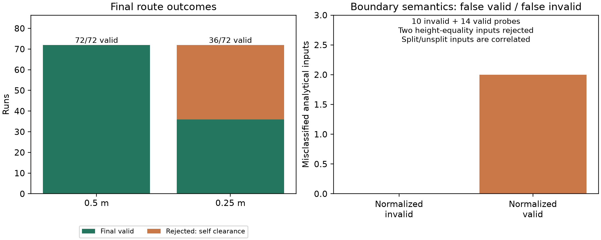

# 공개 기준 사례 보완 결과와 논문 연구성 판정

검토일 2026-10-13. P10D 사례·실험·연구 근거 보완을 완료했다.
판정은 현재 구현, 직접 실행 결과, 공개 선행연구의 선별 검토에 근거한 연구적 판단이다.
원자력에만 한정하지 않고 일반 산업 배관의 공간 제약으로 범위를 잡는다.

## 먼저 내릴 판단

**연구 주제는 성립할 수 있다. 현재 자료만으로 KCI 게재 가능성이나 석사논문 심사 통과를 보장할 수는 없다.**
현재는 기능이 풍부한 연구용 구현과 제한된 합성 실험이다. 새로운 라우팅 알고리즘의 기여는 약하고,
규칙 저장/승인/근거 표시만으로는 학술적 신규성의 근거가 부족하다.
공개 기준 사례를 추가한 것은 적용 범위를 구체화한 보완이며 신규성을 자동으로 만들지 않는다.
석사 응용 연구로 발전할 여지는 있으나 제출 준비가 완료된 상태로 판단하지 않는다.

가장 설득력 있는 연구 질문은 다음과 같이 좁힐 수 있다.

> 설계 요구를 공간 제약으로 변환할 때 생기는 보수적 차단과 경계 의미의 차이가
> 배관 경로의 유효성·비용·변경 해석에 어떤 영향을 주며, 이를 원본 기하와 근거 연결로
> 어떻게 구분하고 재현 가능하게 검수할 수 있는가?

제목 후보: **「공개 설계 제약의 공간 변환과 3차원 배관 경로의 변경 영향 검증」**.
‘화력발전소 배관 자동 설계 완성’, ‘규제 적합성 보장’, ‘최초 규칙 기반 라우팅’은 주장하지 않는다.

## 실행 가능한 공개 기준 사례

| 사례 | 원문 범위 | 정규화와 실행 | 남은 해석 한계 |
|---|---|---|---|
| WALL-SMALL | UFGS 건물 난방 증기/응축수, 호칭 크기 100 mm 이하 | 벽 MIN_CLEARANCE 0.15 m | 단열 외피 바깥의 여유로 적용한 부분은 보수적 연구 정책 |
| WALL-LARGE | 같은 문서, 호칭 크기 100 mm 초과 | 벽 MIN_CLEARANCE 0.25 m | 외경으로 호칭경을 추정하지 않음; 실제 배관 규격 선정은 미검토 |
| ELECTRICAL | OSHA 지정 실내 전기기기 전용 공간, 보호 예외 없는 외부 배관 | 기기 폭/깊이, 기기 상부 1.83 m와 구조 천장으로 정한 Zone KEEP_OUT | 보호 조치·스프링클러·실외 등의 예외를 일반화하지 않음 |
| THERMAL-WALKWAY | Uppur 2×800 MW 석탄 화력 프로젝트의 LP overhead 배관 | 보행면 위 2.5 m 공간을 KEEP_OUT으로 표현 | 지지대/열변위 미검토; 경계 접촉 금지는 정규화 요구보다 엄격 |

원문:
- [UFGS §3.1.1](https://www.wbdg.org/FFC/DOD/UFGS/UFGS%2023%2022%2026.00%2020.pdf), PDF p.24.
- [OSHA §1910.303(g)(1)(vii)(A)](https://www.osha.gov/laws-regs/regulations/standardnumber/1910/1910.303).
- [BHEL 공개 프로젝트 시방서](https://www.bhel.com/sites/default/files/1-technical-specification-part-1-1511852976.pdf), §13.5.3, 다운로드 PDF p.83 / 인쇄 Vol.III:304.

마지막 문서는 특정 화력 프로젝트의 공개 설계 시방서이며 모든 화력발전소에 적용되는 법규가 아니다.
다운로드 문서의 실제 쪽 수는 200이며 통합 footer의 ‘of 305’와 다르다.
깨진 글꼴 문자 매핑을 판독해 원문 조항을 확인했고 검색 색인의 p.183 표시를 인용 쪽으로 사용하지 않았다.
원문 SHA-256 및 세 출처의 열람 한계는 [출처 목록](../../benchmarks/public_reference_sources.json)에 있다.
앞선 [현실성 검토](2026-10-13-rule-realism-review.md)의 국내 현행 조문/유료 원문 미검증 한계는 유지된다.

4개 [검토용 JSON](../../benchmarks/public_examples/)은 초안 상태다.
실험에서는 합성 승인 선언을 사용했으며 전문가나 규제기관의 승인으로 표현하지 않는다.
프로젝트의 공간·배관·실행 제약 데이터는 EngineeringProject JSON 하나로 유지했다.

## 직접 실행 결과

최종 보존 배치: `data/benchmarks/P10D-20261013T073806Z-3b3281e648244d51a898da40efb729d4/`.
4개 합성 장면, 3개 규칙 상태, 2개 해상도, 2개 알고리즘, 3회 반복으로 144회 실행했다.
독립 장면 수는 **4**이고 해상도·알고리즘·반복을 새 장면으로 세지 않는다.

| 지표 | 결과 | 해석 |
|---|---:|---|
| 최종 경로 성공 | 108/144 | 성공률 100%가 아님 |
| 0.5 m / 0.25 m 최종 성공 | 72/72 / 36/72 | 이 입력에서 가는 격자가 최종 성공을 보장하지 않음 |
| 최종 검증 거부 | 36/144 | 3개 장면의 가는 격자·규칙 적용/출처 대조에서 목표 연결선 자기 간섭 |
| 명시한 연속 우회 witness | 4/4 유효 | 장면에 연속 경로가 있어도 현재 탐색이 유효 경로를 반드시 찾지 못함 |
| 분석적 계약 판정/근거 검사 | 24/24 일치 | 4장면×3거리×분할/비분할; 상관된 입력이며 법규 해석 정답은 아님 |
| 정규화 요구 기준 거짓 유효 | 0/10 무효 입력 | 이 제한된 입력에서의 결과 |
| 정규화 요구 기준 거짓 무효 | 2/14 유효 입력 | 통로 높이 일치 1경로의 분할/비분할 표현 |
| 객체·구간 링크 TP / FP / FN | 18 / 0 / 0 | 입력 규칙에 대한 연결 정확성; 원문 해석 정확성을 뜻하지 않음 |
| 초안/미재승인 변경 차단 | 8/8 | 합성 입력의 실행 통제 |
| 유효 비용 비교쌍 | 10/16 | 첫 반복·알고리즘별 비교; 무효 결과의 비용 차이는 제외 |
| 기존 경로가 유효한데 비용 증가 | 4/10 유효 비교쌍 | 0.5 m의 벽 두 장면, 두 알고리즘; 독립 4장면으로 세지 않음 |



[그림 PDF](evidence/2026-10-13-public-reference-outcomes.pdf),
[기계 판독 근거와 원본 hash](evidence/2026-10-13-public-reference-evidence.json).

### ‘규칙 때문에 바뀌었다’의 정확한 해석

A* 첫 반복을 예로 들면 다음과 같다. Dijkstra의 해당 성공 비교도 같은 비용 변화다.

| 장면 / 격자 | 새 규칙으로 기존 경로 검사 | 새 경로 최종 상태 | Δ길이 / Δbend / Δ목적함수 |
|---|---|---|---|
| 작은 벽 / 0.5 m | VALID | SUCCESS | +1 m / +4 / +9 |
| 큰 벽 / 0.5 m | VALID | SUCCESS | +1 m / +4 / +9 |
| 전기 전용 공간 / 0.5 m | INVALID_ROUTE | SUCCESS | +3 m / +4 / +11 |
| 화력 통로 / 0.5 m | INVALID_ROUTE | SUCCESS | +3 m / +4 / +11 |
| 화력 통로 / 0.25 m | INVALID_ROUTE | SUCCESS | +2 m / +4 / +10 |
| 나머지 세 장면 / 0.25 m | 장면별 VALID/INVALID_ROUTE | INVALID_ROUTE | 유효 비용 차이 계산에서 제외 |

벽 두 장면은 새 최소거리 요구를 기존 연속 경로가 이미 만족한다.
그래도 셀 전체가 확장 상자에 닿으면 막는 compiler 정책 때문에 재탐색 경로가 길어졌다.
따라서 +1 m를 물리적 최소거리 요구가 불가피하게 늘린 길이로 해석하면 과장이다.
이는 ‘요구 조건의 영향’, ‘격자 변환의 영향’, ‘접속 연결/검증 정책의 영향’을 나누어 평가할 이유다.
출처의 연구 주석만 수정한 중립 대조 16쌍은 같은 경로와 비용이었다. 무효 상태의 쌍도 이 중립 검사에는 포함되지만 유효 비용 분석에는 포함되지 않는다.

## 선행연구와 겹치는 부분

아래는 선별 검토이며 전체 문헌의 신규성 부재 증명/최초성 증명은 아니다.

| 선행연구 | 확인한 내용 | 우리 주장에 미치는 영향 |
|---|---|---|
| [Ueng·Huang, 2022](https://www.mdpi.com/1996-1944/15/15/5376) | §3의 feasible space 추출, 식(3)–(4): 배관 반경과 최소/최대 간격으로 허용 공간을 정하고 탐색 | 반경+이격으로 탐색 공간을 제한하는 아이디어를 신규 기여로 주장하기 어려움 |
| [Kang et al., 2024](https://www.mdpi.com/2071-1050/16/7/2770) | 3D 플랜트 라우팅, Dijkstra·우선순위·간섭 회피 | 웹 UI·3D 경로 생성·길이/간섭 고려 자체는 차별성이 약함 |
| [Xie et al., 2022](https://www.mdpi.com/2075-5309/12/7/934) | §2.1의 규칙 구조화/실행식/간격 검사와 근거·오류 객체 표시 | 규칙 저장·실행·근거 표시 역시 기존 연구에 존재 |
| [Markhorst et al., 2024](https://proceedings.open.tudelft.nl/imdc24/article/download/891/903/1260) | PDF pp.2–3의 전문가 기반 설계 규칙·허용 간선, 연료에 따른 구역 제한과 변경/불확실성 최적화 | 계통/배관별 구역 제한이나 미래 변경을 고려하는 것만으로 최초성을 주장할 수 없음 |
| [Kong et al., 2026](https://www.sciencedirect.com/science/article/pii/S2092678226000609) | 출판사 초록의 구조화된 객체·관계 규칙과 LLM 기반 라우팅 개선 | 구조화 규칙 자체의 부재를 상대 연구에 가정하면 안 됨; 본문 미열람 |

Ueng·Huang과 Xie는 출판사/PMC 검색 색인에 노출된 본문을 읽었다. MDPI 직접 본문/PDF 접근은 제한되었고 PDF 쪽은 확정하지 않았다.
Markhorst는 출판사 제공 전체 PDF 해당 부분을 직접 읽었다. Kong은 초록 수준이다.
기존 [주장·비교표](2026-10-13-thesis-claims-and-comparison.md)의 각 논문별 열람 수준도 함께 적용한다.
다른 연구에 승인 해시/원본 구간/교차 검증 기능이 없다고 단정하지 않는다.

## 현재 주장할 수 있는 것과 부족한 것

현재 주장할 수 있는 것은 다음 구성과 한정된 관찰이다.

1. 공개 요구의 조건·예외·측정 기준을 명시한 합성 입력과 실행 결과를 보존했다.
2. 규칙 개입 후 기존 경로 재검증으로 요구 위반과 보수적 격자 변화가 일치하지 않는 사례를 구분했다.
3. 정규화 요구의 경계와 현재 KEEP_OUT 계약의 차이, 연결선 자기 간섭으로 인한 최종 실패를 기록했다.
4. 승인·출처·대상·원본 구간의 연결을 분석적 기준과 중립/변조 대조로 검사했다.

이는 검수 방법과 사례 구성의 후보 기여다. 자체가 기존 연구와 충분히 다른지 아직 확정하지 못했다.
‘내 구현이 의도대로 동작한다’는 테스트만으로 학술적 결과가 되지는 않는다.

| 심사 관점 | 현재 평가 | 제출 전에 필요한 근거 |
|---|---|---|
| 문제의 필요성 | 규칙 변경과 계산상의 보수성 구분은 의미 있는 질문 | 실제 설계 업무에서의 필요성에 대한 공개 자료/설계자 의견 |
| 방법의 신규성 | 낮거나 미확정; 새 탐색 알고리즘 아님 | 같은 변경 검증·설계 제약 평가 연구와 본문 수준 비교 |
| 평가의 독립성 | 생산 마스크와 다른 연속 검사·분석적 경로가 있으나 제한적 | 외부 검토한 규칙 해석/정답, 다른 기하 기준 또는 분석적 증명 확대 |
| 실험의 일반화 | P10B/C와 P10D 모두 제한된 합성 범위 | 여러 기하 family, 별도 평가 seed, 실패를 포함한 집계 |
| 실무 유용성 | 화면과 기능은 구현했지만 효과 미입증 | 비교 작업 흐름, 오류 발견·수정 효과 또는 전문가 사례 평가 |
| 재현성 | 입력/소스/결과가 로컬에 보존됨 | 제출용 버전 고정과 원본 배치의 공개 배포 위치 |

## 제출을 위한 좁은 연구 설계

핵심 질문과 지표를 세 축으로 정리하는 것이 타당하다.

- **공간 변환 충실도:** 정규화 요구를 만족하는 연속 witness가 얼마나 차단되는가?
  참조 유효/무효 경로의 false valid·false invalid, 알려진 feasible 장면의 최종 유효 성공률, 최소 실제 간격을 측정한다.
- **변경 해석:** 비용/형상 변화가 기존 경로의 실제 요구 위반과 얼마나 일치하는가?
  old-under-new/new-under-old 교차 판정, Δ길이·Δbend·Δ목적함수, ‘기존 경로 유효인데 변경’ 비율을 장면 단위로 집계한다.
- **근거 정확성:** 변경/위반의 규칙·출처·대상·원본 구간을 올바르게 연결하는가?
  사람 또는 분석적으로 정한 정답에 대한 precision/recall, 누락/오연결과 미승인/변조 차단을 측정한다.

같은 solver와 목적함수를 유지한 채 (a) 격자 결과만 믿는 처리, (b) 원본 기하 재검증,
(c) 요구 해석/변경 대조까지 포함한 처리의 진단 결과를 비교할 수 있다.
이는 평가 절차의 절제 대조이며 다른 논문의 구현을 재현한 비교 실험으로 쓰지 않는다.
A*–Dijkstra는 보조 검수이고 주된 신규성 근거로 두지 않는다.

추가 장면은 거리 임계값·좁은 통로·포트 offset·경계 접촉·서로 겹치는 규칙을 체계적으로 변화시키고,
여러 family와 미사용 평가 seed를 분리한다. 반복 실행은 runtime의 중앙값에 사용하고
표본 수/신뢰구간은 장면·seed/family의 상관을 고려한다. 요구 해석은 외부 검토를 받아 가정을 수정한다.
이번 4개 사례의 실패 분류는 발견 후 정한 분석이므로 후속 평가에서는 기준을 미리 고정해야 한다.

이 확장과 비교가 성공하면 응용/검증 방법 중심의 석사논문이나 KCI 투고 원고로 발전할 수 있다.
현재 자료만으로 게재나 졸업 수준을 확정할 수 없고, 지도교수·학과·목표 학술지의 심사 판단은 별도다.
LLM/온톨로지나 다배관 기능을 추가하는 것이 이 증거 부족을 자동으로 해결하지 않는다.

## 재현과 직접 검수

```powershell
# 새 배치 생성: existing measured batches remain separate
uv run python scripts/run_public_reference_study.py

# 보존 배치의 그림·비교 요약 생성 (새 실행은 출력 batch 경로로 대체)
uv run python scripts/report_public_reference_study.py data/benchmarks/P10D-20261013T073806Z-3b3281e648244d51a898da40efb729d4

# 새 폴더에 사람 검토용 draft JSON 내보내기 (기존 파일을 덮어쓰지 않음)
uv run python scripts/run_public_reference_study.py --export-examples data/benchmarks/review-drafts

# 원문 PDF를 위 source URL에서 내려받은 뒤 별도 임시 의존성으로 판독
uv run --with pypdf python scripts/audit_public_pdf.py --pdf data/benchmarks/public_source_cache/uppur-pe-ts-425-166-a001.pdf --pages 83
```

255개 Python 테스트 통과(33.41 s), Ruff 최종 통과, frontend build 통과.
기존 Starlette/httpx 폐기 예정 경고와 frontend 500 kB 초과 청크 경고가 있었다.
P10D 144회와 24 probe·8 승인 통제를 직접 실행했다. 생성 PNG를 직접 확인했다.
프런트 수정·브라우저 UI 회귀·기존 P10B/C 전체 재실행은 이번 작업에서 수행하지 않았다.
새 clone에는 Git 제외된 원본 배치와 PDF 캐시가 없으므로 재실행하거나 별도 배포 자료가 필요하다.

수동 UI 확인 절차: `benchmarks/public_examples/*.json`을 프로젝트 탭의 JSON 편집에 붙여넣고
‘JSON 검증’을 누른다. 초안 규칙을 검토·승인하기 전 계산이 차단되는 것을 확인하고,
승인 후 0.5 m 경로와 같은 JSON의 0.25 m 진단 결과를 비교한다. 이 절차의 브라우저 실행은 미실시다.

다음 작업 후보는 연결선을 포함한 재탐색 보완, 같은 평가 축의 선행연구 원문 확보,
외부 검토한 규칙 해석과 더 넓은 고정 평가 집합이다. 이번 작업에서 다음 Phase를 자동 진행하지 않았다.
